## Identitas

- Nama           : [Nur Wahyu Muhtiin Haniv]
- NPM            : [4525210078]
- Mata Kuliah    : [Praktikum PBO-A]
- Dosen Pengampu : [Adi Wahyu Pribadi, S.Si., M.Kom]

---

## RekeningBank.java

### Sebelum

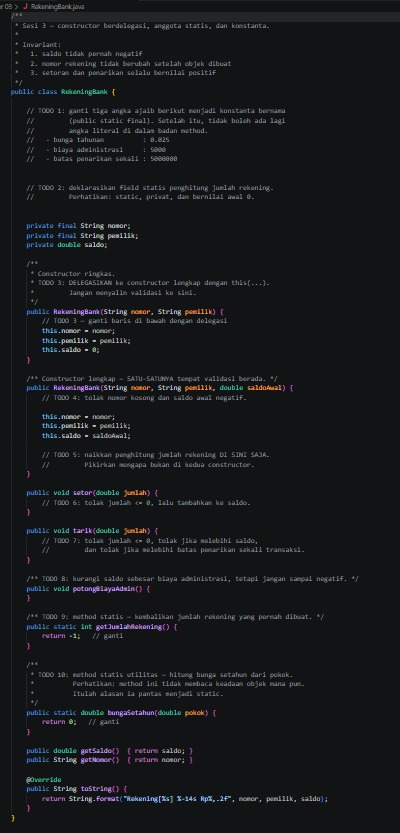

Kerangka kelas rekening bank dengan 10 TODO. Yang diminta:
1. Ganti angka ajaib (bunga 0.025, biaya admin 5000, batas tarik 5.000.000) menjadi konstanta `public static final`.
2. Deklarasikan penghitung jumlah rekening: `static`, privat, bernilai awal 0.
3. Constructor ringkas harus mendelegasikan ke constructor lengkap dengan `this(...)`.
4. Constructor lengkap menolak nomor kosong dan saldo awal negatif.
5. Naikkan penghitung hanya di constructor lengkap.
6. `setor()` menolak jumlah <= 0 lalu menambah saldo.
7. `tarik()` menolak jumlah <= 0, melebihi saldo, dan melebihi batas sekali tarik.
8. `potongBiayaAdmin()` mengurangi saldo, tetapi saldo tidak boleh negatif.
9. `getJumlahRekening()` adalah method statis yang mengembalikan jumlah rekening.
10. `bungaSetahun()` adalah method statis utilitas penghitung bunga.

Pada kode yang diunggah, sebagian TODO sudah terisi tetapi nama konstanta masih huruf kecil (`bunga_tahunan`, dan seterusnya) dan masih ada salah ketik pada pesan error.

### Setelah

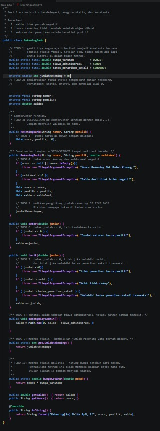

- Konstanta diganti ke gaya `UPPER_SNAKE_CASE`: `BUNGA_TAHUNAN`, `BIAYA_ADMINISTRASI`, `BATAS_PENARIKAN_SEKALI`. Tidak ada angka literal di dalam method.
- `jumlahRekening` adalah `private static int` bernilai awal 0.
- Constructor ringkas hanya berisi `this(nomor, pemilik, 0)`, jadi validasi tidak disalin.
- Constructor lengkap adalah satu-satunya tempat validasi. Nomor `null` atau kosong (setelah di-trim) dan saldo awal negatif ditolak dengan `IllegalArgumentException`.
- `jumlahRekening++` hanya ada di constructor lengkap. Kalau juga ada di constructor ringkas, rekening yang dibuat lewat constructor ringkas terhitung dua kali (hasilnya 4, bukan 3).
- `setor()` dan `tarik()` memvalidasi sesuai invariant. Pesan error yang salah ketik sudah diperbaiki.
- `potongBiayaAdmin()` memakai `Math.max(0, ...)` supaya saldo tidak negatif.
- `getJumlahRekening()` dan `bungaSetahun()` bersifat `static` karena tidak membaca keadaan objek mana pun.

---

## Main.java

### Sebelum

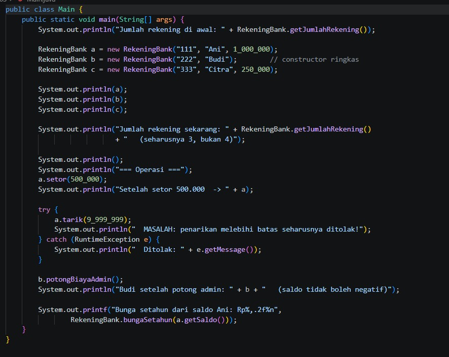

Program uji. Ia membuat tiga rekening (satu lewat constructor ringkas), mencetak jumlah rekening yang seharusnya 3, melakukan setor, mencoba tarik melebihi batas, memotong biaya admin, dan menghitung bunga setahun.

### Setelah

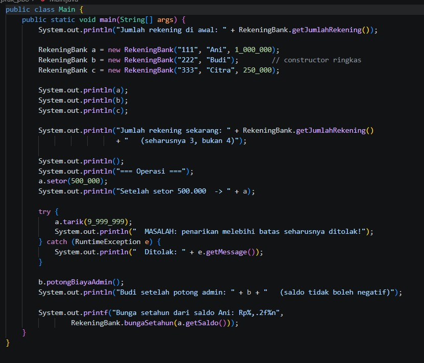

Tidak ada perubahan pada `Main.java`. Program ujinya sama, dan seluruh perilakunya sekarang ditopang oleh `RekeningBank.java` yang sudah rapi.

---

## RekeningBank.php

### Sebelum

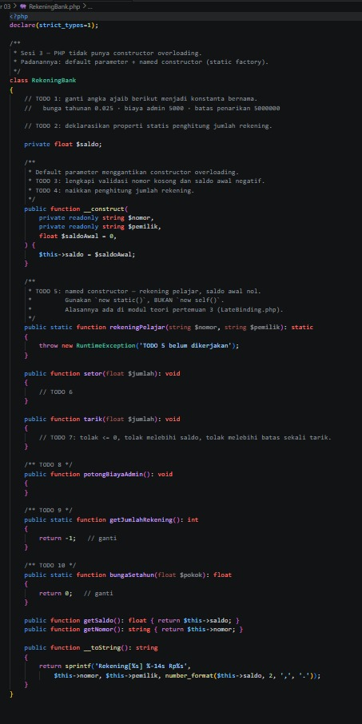

Versi PHP dari kelas yang sama. PHP tidak punya constructor overloading, jadi padanannya adalah default parameter (`$saldoAwal = 0`) dan named constructor `rekeningPelajar()`. Yang diminta sama dengan versi Java, ditambah:
- `rekeningPelajar()` harus memakai `new static()`, bukan `new self()`.
- Penghitung berupa properti statis (`self::$jumlahRekening`).

Pada kondisi ini program langsung berhenti dengan fatal error `TODO 5 belum dikerjakan`.

### Setelah

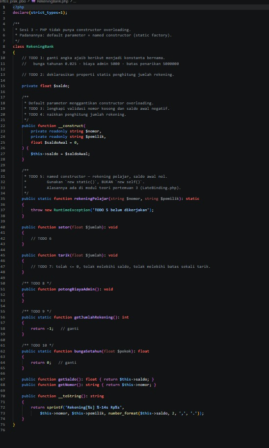

- Konstanta memakai `public const float` (PHP 8.3 ke atas).
- `private static int $jumlahRekening = 0` menjadi penghitung, dan dinaikkan di constructor dengan `self::$jumlahRekening++`.
- Constructor memakai `trim()` untuk menolak nomor kosong dan menolak saldo awal negatif dengan `InvalidArgumentException`.
- `rekeningPelajar()` mengembalikan `new static($nomor, $pemilik)`. Saldo awal otomatis 0 dari default parameter, dan `static` membuat kelas turunan menghasilkan objek dari kelasnya sendiri (late static binding).
- `setor()` dan `tarik()` memvalidasi sesuai invariant. Jumlah tidak positif memakai `InvalidArgumentException`, sedangkan saldo kurang dan melebihi batas memakai `RuntimeException`.
- `potongBiayaAdmin()` memakai `max(0, ...)`, `getJumlahRekening()` mengembalikan penghitung, dan `bungaSetahun()` mengalikan pokok dengan `BUNGA_TAHUNAN`.

---

## Main.php

### Sebelum

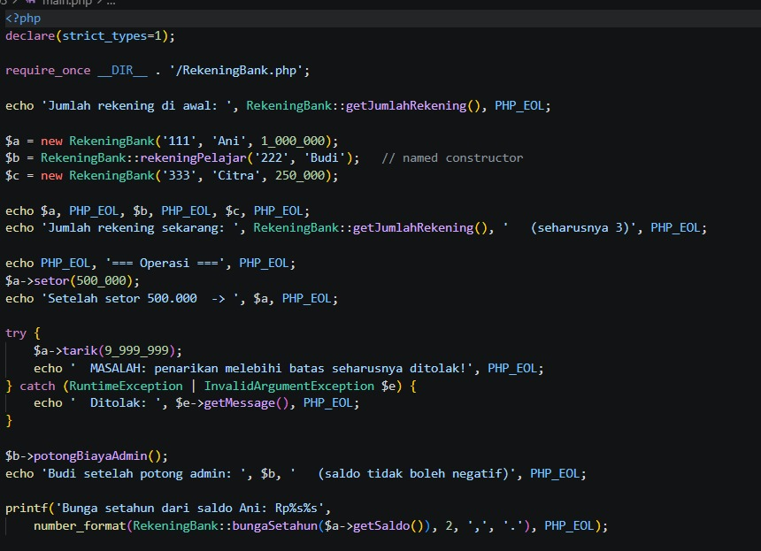

Program uji versi PHP. Ia membuat rekening biasa, rekening pelajar lewat named constructor, lalu menjalankan operasi setor, tarik, potong admin, dan bunga. Pada zip, file ini berada di folder `java/` bersama `RekeningBank.php`, tetapi kodenya adalah PHP.

### Setelah

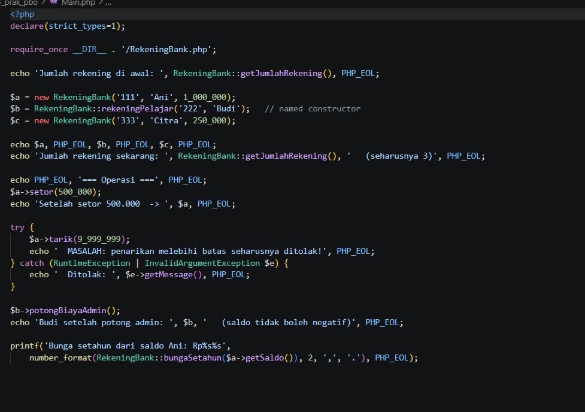

Tidak ada perubahan pada `Main.php`. Sekarang program berjalan sampai selesai karena `RekeningBank.php` sudah dilengkapi.

---

## Hasil Keseluruhan

### Sebelum (Java)

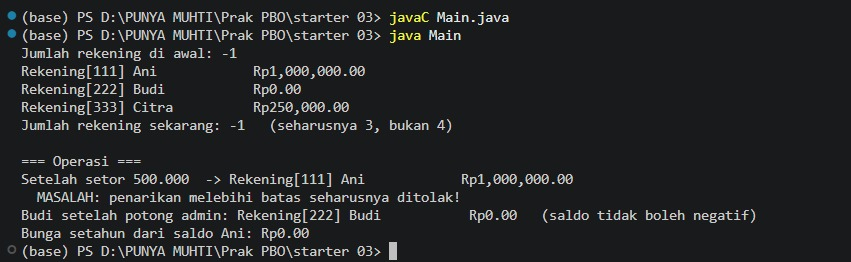

Program Java sudah jalan karena sebagian besar TODO telah terisi, tetapi penamaan konstanta belum sesuai konvensi dan masih ada salah ketik.

### Sebelum (PHP)

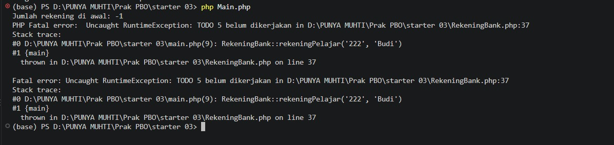

Jumlah rekening awal bernilai -1 dan program berhenti dengan fatal error karena `rekeningPelajar()` belum dikerjakan.

### Setelah (Java)

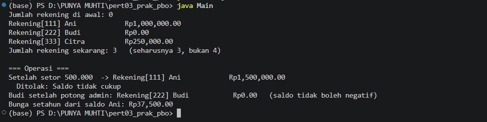

### Setelah (PHP)

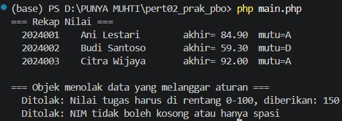

### Kesimpulan

Setelah semua TODO dilengkapi, versi Java dan PHP menghasilkan perilaku yang sama. Jumlah rekening tepat 3, setoran menambah saldo Ani menjadi 1.500.000, penarikan 9.999.999 ditolak, saldo Budi tetap 0 setelah dipotong biaya admin, dan bunga setahun dari saldo Ani adalah 37.500. Hanya format angka yang berbeda: Java mencetak `1,500,000.00` dan PHP mencetak `1.500.000,00`.

Konsep yang dipelajari:
- Constructor berdelegasi (`this(...)`) membuat validasi hanya ditulis sekali dan penghitung tidak terhitung ganda.
- Anggota `static` (penghitung dan method utilitas) milik kelas, bukan milik objek.
- Konstanta bernama menggantikan angka ajaib, sehingga perubahan aturan cukup dilakukan di satu tempat.
- PHP menggantikan constructor overloading dengan default parameter dan named constructor, dengan `new static()` agar mendukung pewarisan.
