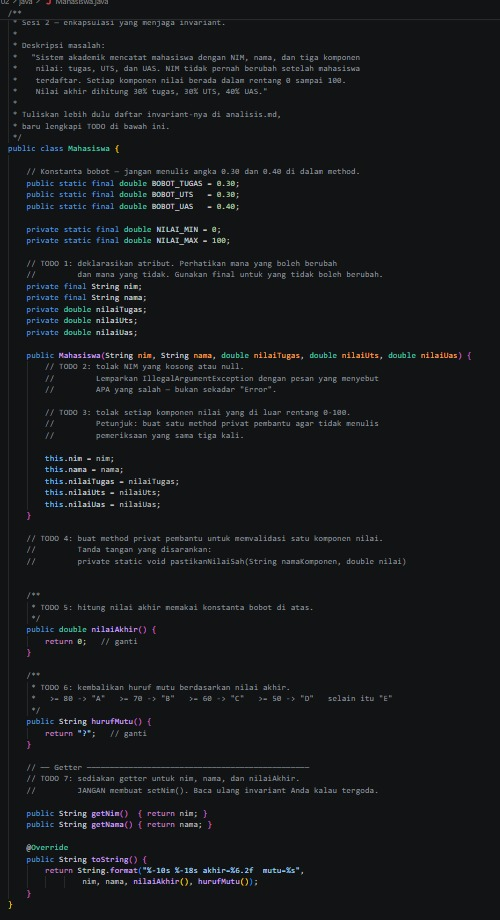
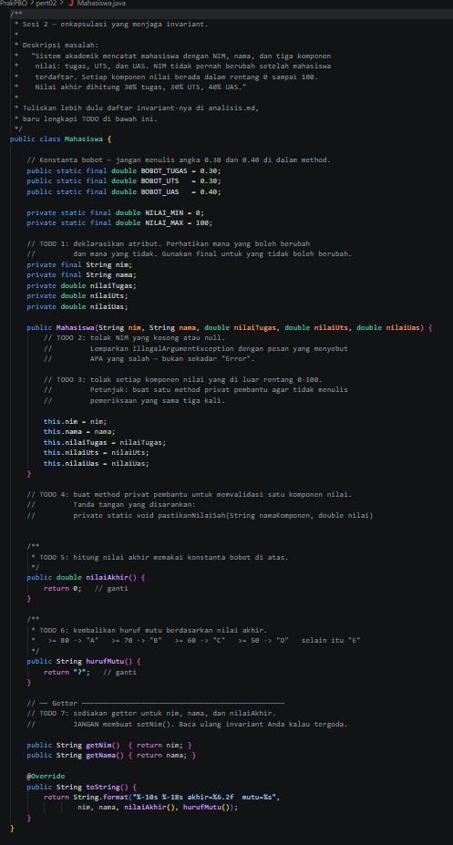
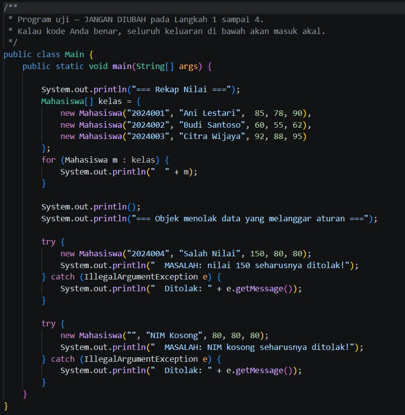
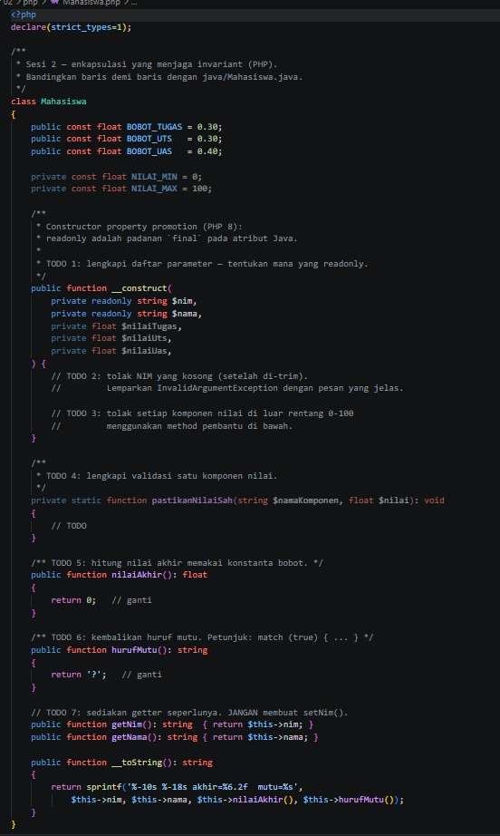

## Identitas

- Nama           : [Nur Wahyu Muhtiin Haniv]
- NPM            : [4525210078]
- Mata Kuliah    : [Praktikum PBO-A]
- Dosen Pengampu : [Adi Wahyu Pribadi, S.Si., M.Kom]

---

## Mahasiswa.java

### Sebelum

Kode masih berupa kerangka dengan 7 TODO. Yang diminta:
1. Deklarasikan atribut. `nim` dan `nama` memakai `final` karena tidak boleh berubah, sedangkan tiga nilai boleh berubah.
2. Tolak NIM kosong atau `null` dengan `IllegalArgumentException` yang pesannya jelas.
3. Tolak nilai tugas, UTS, dan UAS yang di luar rentang 0-100.
4. Buat method privat pembantu `pastikanNilaiSah` supaya pemeriksaan tidak ditulis tiga kali.
5. Hitung `nilaiAkhir()` memakai konstanta bobot (30% tugas, 30% UTS, 40% UAS).
6. Tentukan `hurufMutu()`: >= 80 A, >= 70 B, >= 60 C, >= 50 D, selain itu E.
7. Sediakan getter, dan jangan membuat `setNim()`.

### Setelah

- Atribut `nim` dan `nama` bersifat `private final`, sehingga NIM tidak bisa diubah setelah objek dibuat.
- Constructor memeriksa NIM (`null` atau kosong setelah di-trim) dan melempar `IllegalArgumentException("NIM tidak boleh kosong atau null")`. Pemeriksaan ini dilakukan sebelum atribut diisi, jadi objek yang tidak sah tidak pernah terbentuk.
- `pastikanNilaiSah(namaKomponen, nilai)` dipanggil tiga kali di constructor. Pesan errornya menyebut komponen mana yang salah, rentang yang benar, dan nilai yang diterima.
- `nilaiAkhir()` memakai `BOBOT_TUGAS`, `BOBOT_UTS`, `BOBOT_UAS`, tanpa angka 0.30 atau 0.40 di dalam method.
- `hurufMutu()` memakai rangkaian `if` dari nilai tertinggi ke terendah.
- Ada getter `getNim()`, `getNama()`, `getNilaiAkhir()`. Tidak ada `setNim()`.

---

## Main.java

### Sebelum

Program uji yang tidak boleh diubah. Ia membuat tiga mahasiswa lalu mencetak rekap nilai. Setelah itu ia mencoba membuat objek dengan nilai 150 dan NIM kosong, dan keduanya seharusnya ditolak.

### Setelah

Kode tidak berubah, sesuai instruksi. Isinya sama persis dengan sebelumnya, tetapi sekarang keluarannya benar karena `Mahasiswa.java` sudah dilengkapi. Dua blok `try-catch` menangkap `IllegalArgumentException` dan mencetak pesan penolakan.

---

## Mahasiswa.php

### Sebelum

Versi PHP dari kelas yang sama, dengan TODO yang sama. Perbedaannya:
- Atribut dideklarasikan lewat constructor property promotion, dan `readonly` setara dengan `final` di Java.
- Exception yang dipakai adalah `InvalidArgumentException`.
- Huruf mutu dianjurkan memakai `match (true) { ... }`.

### Setelah

- `nim` dan `nama` ditandai `private readonly`, jadi tidak bisa diubah setelah objek dibuat.
- Constructor memakai `trim($nim) === ''` untuk menolak NIM kosong, lalu memanggil `self::pastikanNilaiSah()` untuk tiap nilai.
- `pastikanNilaiSah()` melempar `InvalidArgumentException` dengan pesan yang menyebut komponen, rentang, dan nilai yang diterima.
- `nilaiAkhir()` memakai konstanta `self::BOBOT_*`.
- `hurufMutu()` memakai `match (true)` dengan cabang `default` untuk huruf E.
- Ada getter `getNim()`, `getNama()`, `getNilaiAkhir()`. Tidak ada `setNim()`.

---

## main.php

### Sebelum

Program uji versi PHP. Ia memuat `Mahasiswa.php`, mencetak rekap tiga mahasiswa, lalu mencoba membuat objek dengan nilai 150 dan NIM kosong yang harus ditolak.

### Setelah

Kode tidak berubah. Hasil keluarannya menjadi benar karena `Mahasiswa.php` sudah lengkap. Blok `try-catch` menangkap `InvalidArgumentException` dan mencetak pesan penolakannya.

---

## Hasil Keseluruhan

### Sebelum (kerangka belum dilengkapi, Java)

Semua nilai akhir 0.00, mutu `?`, dan muncul pesan MASALAH karena nilai 150 serta NIM kosong tidak ditolak.

### Setelah (Java)

### Setelah (PHP)

### Kesimpulan

Setelah semua TODO dilengkapi, versi Java dan PHP menghasilkan keluaran yang sama. Nilai akhir Ani 84.90 (A), Budi 59.30 (D), dan Citra 92.00 (A), dan kedua data yang melanggar aturan ditolak dengan pesan yang jelas. Ini menunjukkan enkapsulasi menjaga invariant:
- NIM tidak bisa diubah (`final` di Java, `readonly` di PHP, dan tidak ada `setNim()`).
- Nilai di luar 0-100 dan NIM kosong ditolak langsung di constructor, sehingga objek yang tidak sah tidak pernah ada.
- Bobot nilai disimpan sebagai konstanta, jadi perubahan bobot cukup dilakukan di satu tempat.
- Dua bahasa yang berbeda bisa menerapkan konsep yang sama dengan sintaks yang berbeda.
