## Identitas

- Nama           : [Nur Wahyu Muhtiin Haniv]
- NPM            : [4525210078]
- Mata Kuliah    : [Praktikum PBO-A]
- Dosen Pengampu : [Adi Wahyu Pribadi, S.Si., M.Kom]

---

## Buku.java

### Sebelum

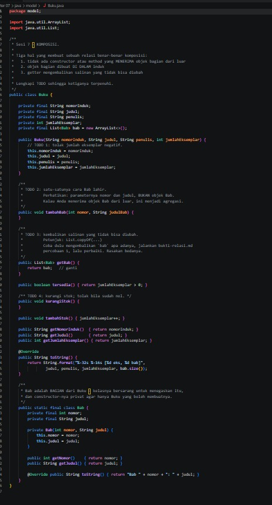

Bahan untuk KOMPOSISI. Sebuah relasi benar-benar komposisi bila memenuhi tiga hal:
1. Tidak ada constructor atau method yang menerima objek bagian dari luar.
2. Objek bagian dibuat di dalam induk.
3. Getter mengembalikan salinan yang tidak bisa diubah.

TODO yang diminta:
1. Tolak jumlah eksemplar negatif.
2. `tambahBab(nomor, judul)` sebagai satu-satunya cara `Bab` lahir. Parameternya nomor dan judul, bukan objek `Bab`.
3. `getBab()` mengembalikan salinan yang tidak bisa diubah.
4. `kurangiStok()` mengurangi stok dan menolak bila sudah nol.

Pada tahap ini `tambahBab` dan `kurangiStok` masih kosong, dan `getBab()` mengembalikan list aslinya.

### Setelah

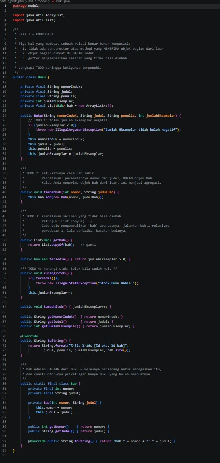

- Constructor melempar `IllegalArgumentException` bila jumlah eksemplar negatif.
- `tambahBab(int, String)` membuat `new Bab(nomor, judulBab)` di dalam `Buku`. Kelas `Bab` bersarang (`static final class`) dengan constructor `private`, sehingga hanya `Buku` yang bisa membuatnya.
- `getBab()` mengembalikan `List.copyOf(bab)`. Karena itu `buku.getBab().clear()` dari luar ditolak dengan `UnsupportedOperationException`, dan daftar bab asli aman.
- `kurangiStok()` melempar `IllegalStateException("Stock Buku Habis.")` bila stok nol, lalu mengurangi stok.
- Ketiga syarat komposisi terpenuhi, sehingga `Bab` tidak bisa hidup di luar `Buku`.

---

## Jurusan.java

### Sebelum

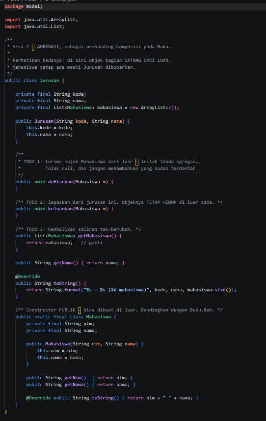

Bahan untuk AGREGASI, sebagai pembanding komposisi. Di sini objek bagian datang dari luar: `Mahasiswa` tetap ada meski `Jurusan` dibubarkan, dan constructor `Mahasiswa` bersifat publik. TODO yang diminta:
1. `daftarkan()` menerima `Mahasiswa` dari luar, menolak null, dan tidak menambah yang sudah terdaftar.
2. `keluarkan()` melepaskan mahasiswa dari jurusan tanpa menghapus objeknya.
3. `getMahasiswa()` mengembalikan salinan tak-berubah.

### Setelah

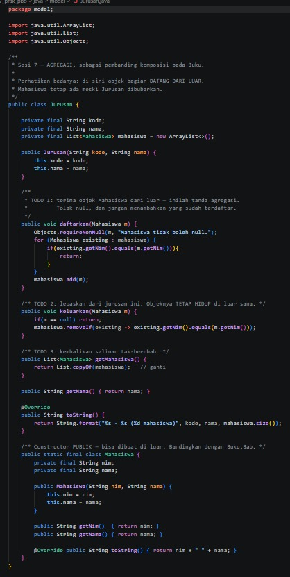

- `daftarkan()` memakai `Objects.requireNonNull` untuk menolak null dan mengabaikan mahasiswa dengan NIM yang sudah ada.
- `keluarkan()` memakai `removeIf` berdasarkan NIM. Objek `Mahasiswa` tidak terpengaruh dan tetap hidup di luar.
- `getMahasiswa()` mengembalikan `List.copyOf(mahasiswa)`.
- Bedanya dengan komposisi: bagian dibuat di luar lalu diserahkan, dan hidupnya tidak bergantung pada induk.

---

## PerpustakaanService.java

### Sebelum

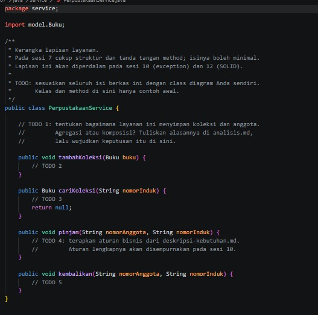

Kerangka lapisan layanan yang isinya boleh minimal. Pertanyaan pada TODO 1: layanan ini menyimpan koleksi dan anggota sebagai agregasi atau komposisi, lalu wujudkan keputusannya.

### Setelah

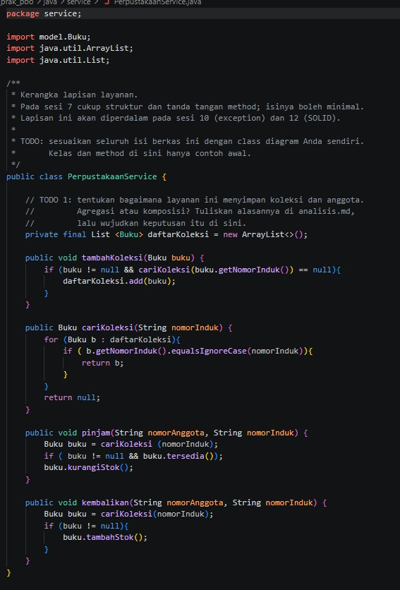

- Keputusannya AGREGASI. `tambahKoleksi(Buku)` menerima objek dari luar, dan koleksi tetap ada walau layanan dibubarkan.
- `tambahKoleksi()` menolak null dan nomor induk yang sudah ada, dan `cariKoleksi()` mencari berdasarkan nomor induk.
- `pinjam()` sekarang melempar `IllegalArgumentException` bila koleksi tidak ditemukan, lalu memanggil `buku.kurangiStok()`, yang menolak sendiri bila stok habis. Pada kode yang diunggah ada titik koma nyasar setelah `if (buku != null && buku.tersedia());`, sehingga baris `kurangiStok()` selalu jalan dan akan error `NullPointerException` bila buku tidak ditemukan. Itu sudah diperbaiki.
- `kembalikan()` menambah stok koleksi yang ditemukan.

---

## Main.java

### Sebelum

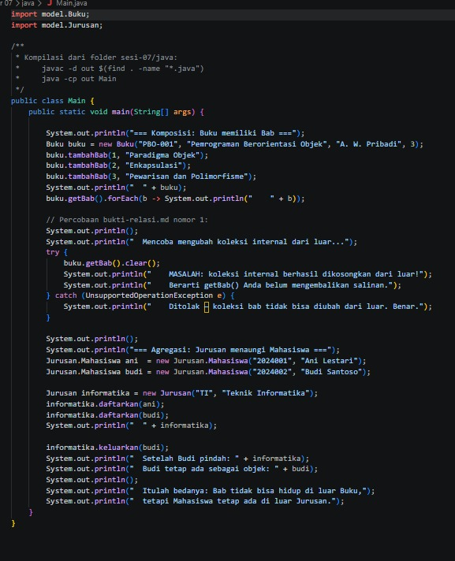

Program uji. Ia mendemokan komposisi (`Buku` dengan `Bab`, termasuk percobaan mengosongkan `getBab()` dari luar) dan agregasi (`Jurusan` dengan `Mahasiswa`).

### Setelah

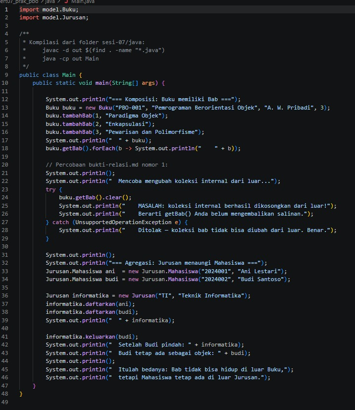

Tidak ada perubahan pada `Main.java`. Keluarannya sekarang benar karena `Buku` dan `Jurusan` sudah dilengkapi.

---

## relasi.php

### Sebelum

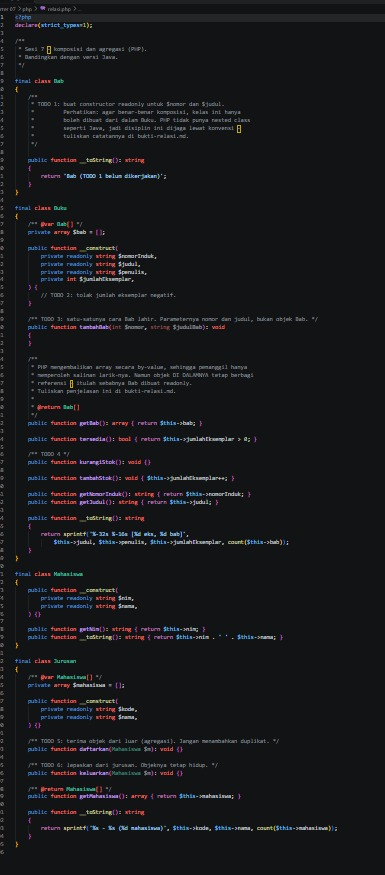

Versi PHP yang memuat enum `JenisKeanggotaan` dan `StatusKoleksi`, serta kelas `Bab`, `Buku`, `Mahasiswa`, dan `Jurusan`. TODO yang diminta:
1. `Bab` memakai constructor `readonly`.
2. `Buku` menolak jumlah eksemplar negatif.
3. `tambahBab(nomor, judul)` sebagai satu-satunya cara `Bab` lahir.
4. `kurangiStok()` menolak bila stok nol.
5. `Jurusan::daftarkan()` menerima objek dari luar tanpa duplikat.
6. `Jurusan::keluarkan()` melepas mahasiswa tanpa menghapus objeknya.

### Setelah

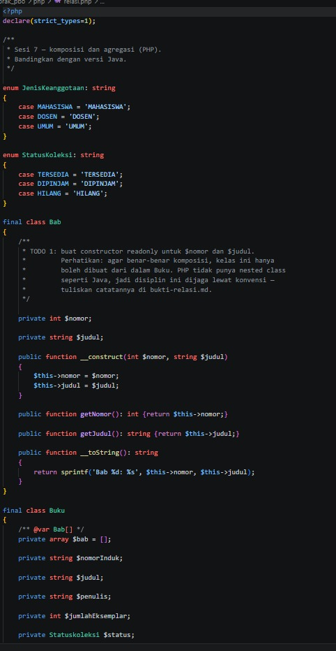
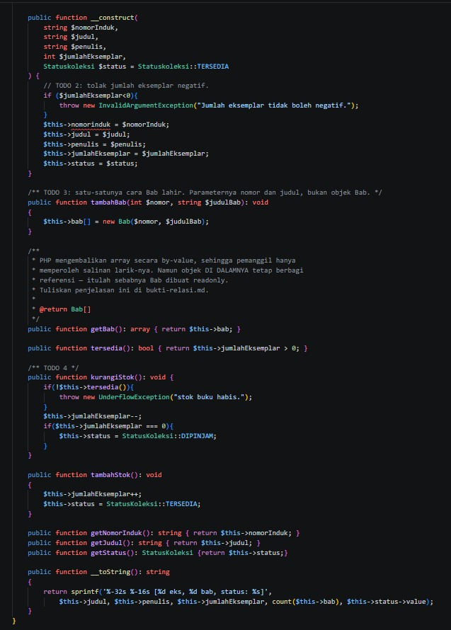
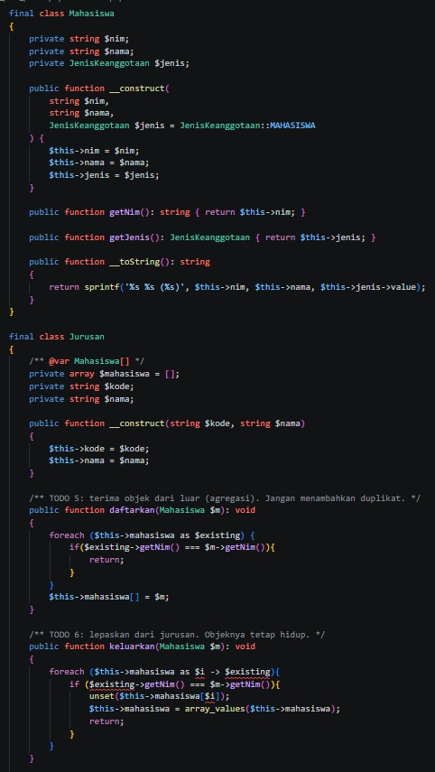
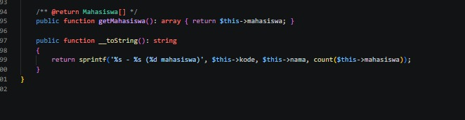

- `Bab` memakai constructor property promotion dengan `private readonly`, jadi tidak bisa diubah setelah dibuat.
- `Buku` melempar `InvalidArgumentException` bila jumlah eksemplar negatif, dan `kurangiStok()` melempar `UnderflowException` bila stok habis. Status koleksi juga ikut berubah (`DIPINJAM` saat stok habis, `TERSEDIA` saat stok bertambah).
- `tambahBab()` membuat `new Bab(...)` di dalam `Buku`. PHP tidak punya nested class seperti Java, jadi aturan "Bab hanya dibuat dari dalam Buku" dijaga lewat konvensi.
- `getBab()` mengembalikan array by-value, jadi pemanggil hanya mendapat salinan array-nya. Objek di dalamnya tetap berbagi referensi, itulah sebabnya `Bab` dibuat `readonly`.
- `Jurusan::daftarkan()` mengabaikan duplikat berdasarkan NIM, dan `keluarkan()` melepas mahasiswa lalu merapikan indeks dengan `array_values`.
- Dua kesalahan pada kode yang diunggah sudah diperbaiki. Pertama, `$this->nomorinduk` (huruf kecil) diperbaiki menjadi `$this->nomorInduk`, karena nama properti PHP membedakan huruf besar dan kecil. Kedua, `foreach (... as $i -> $existing)` diperbaiki menjadi `$i => $existing`, karena sebelumnya `keluarkan()` memunculkan fatal error.

---

## main.php

### Sebelum

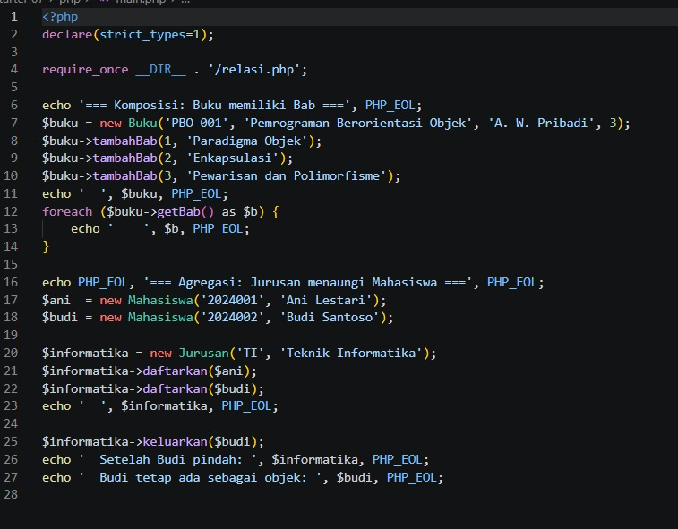

Program uji PHP yang mendemokan komposisi dan agregasi seperti versi Java.

### Setelah

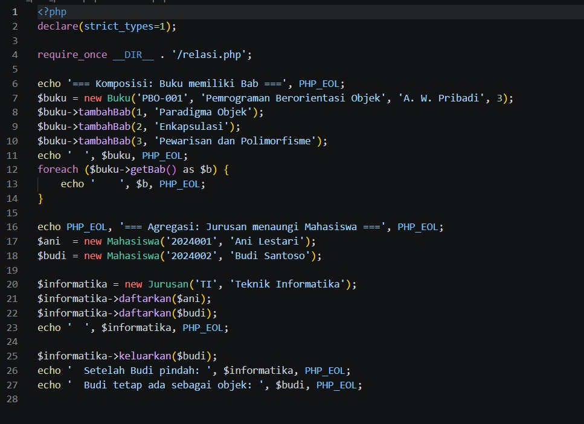

Tidak ada perubahan pada `main.php`. Sekarang program berjalan sampai selesai, termasuk `keluarkan()`.

---

## perpustakaan.puml

### Sebelum

Kerangka class diagram dengan 6 TODO:
1. Tambahkan tiga turunan `Koleksi`: `Buku`, `Majalah`, `Skripsi`.
2. Tambahkan `Anggota` dan `Peminjaman` beserta atributnya.
3. Tambahkan enum `StatusKoleksi` dan `JenisKeanggotaan`.
4. Lengkapi relasi dengan derajat keterikatan dan multiplicity di kedua ujung.
5. Perbaiki relasi yang salah, yaitu `Koleksi <|-- Bab`.
6. Tambahkan relasi `PerpustakaanService` dengan `Koleksi` dan `Anggota`.

### Setelah

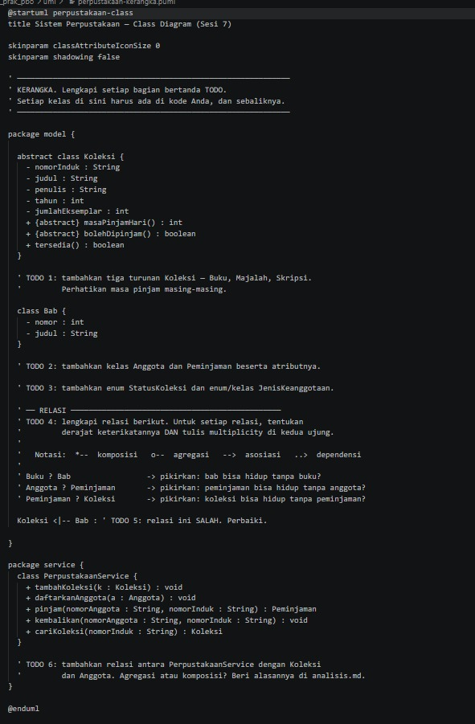

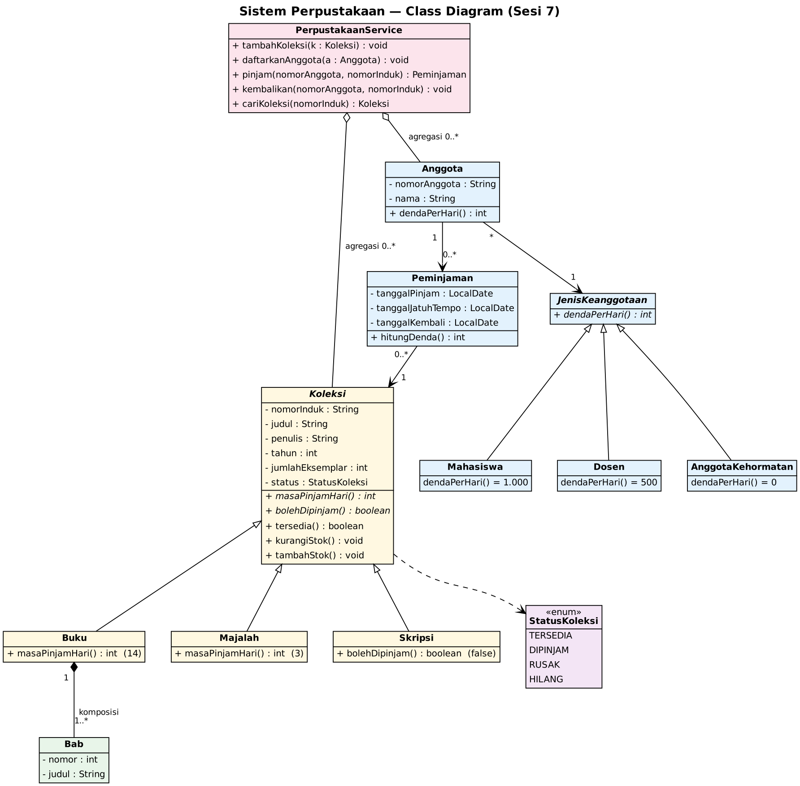

- `Koleksi` abstrak punya tiga turunan: `Buku` (14 hari), `Majalah` (3 hari), dan `Skripsi` (tidak boleh dipinjam).
- Relasi `Koleksi <|-- Bab` salah, karena bab bukan sebuah koleksi. Diganti dengan komposisi `Buku "1" *-- "1..*" Bab`, karena bab tidak punya arti di luar buku.
- `Anggota` dan `Peminjaman` memakai asosiasi (`Anggota "1" --> "0..*" Peminjaman` dan `Peminjaman "0..*" --> "1" Koleksi`). Peminjaman hanya catatan yang merujuk anggota dan koleksi, yang tetap ada walau catatannya dihapus.
- `JenisKeanggotaan` dibuat sebagai kelas abstrak dengan turunan `Mahasiswa` (Rp1.000), `Dosen` (Rp500), dan `AnggotaKehormatan` (Rp0). Dengan begitu, jenis keanggotaan baru yang diperkirakan perpustakaan cukup ditambah sebagai turunan baru tanpa mengubah `Anggota`.
- `StatusKoleksi` berupa enum dengan nilai `TERSEDIA`, `DIPINJAM`, `RUSAK`, `HILANG`.
- `PerpustakaanService` memakai agregasi (`o--`) ke `Koleksi` dan `Anggota`, karena keduanya dibuat di luar layanan.
- Gambar diagram dirender dari rancangan yang sama, memakai Graphviz. Kode PlantUML-nya ada di berkas `perpustakaan.puml`.

---

## Hasil Keseluruhan

### Sebelum (Java)

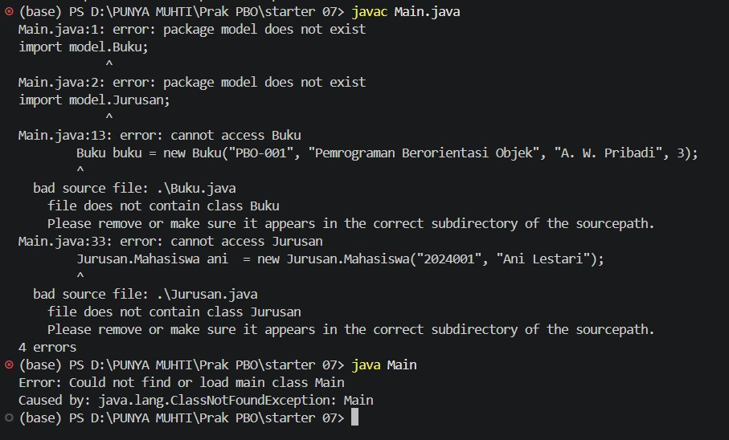

### Sebelum (PHP)

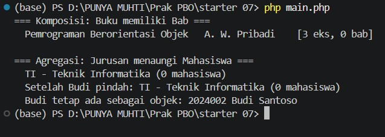

Bab dan mahasiswa tidak tercatat (0 bab, 0 mahasiswa), dan `Main` menampilkan pesan MASALAH karena daftar bab bisa dikosongkan dari luar.

### Setelah (Java)

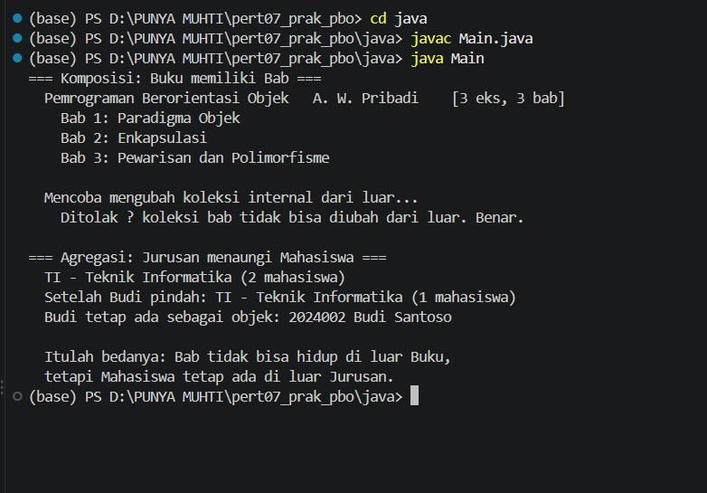

### Setelah (PHP)

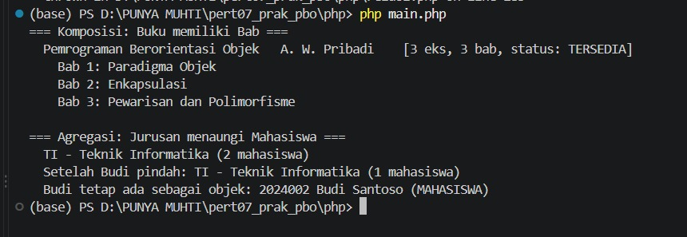

### Kesimpulan

Setelah semua TODO dikerjakan, `Buku` memiliki tiga `Bab`, dan upaya mengosongkan daftar bab dari luar ditolak. `Jurusan` menaungi dua mahasiswa, dan setelah Budi dikeluarkan Budi tetap ada sebagai objek. Itulah bedanya komposisi dan agregasi: `Bab` tidak bisa hidup di luar `Buku`, sedangkan `Mahasiswa` tetap ada di luar `Jurusan`. Java dan PHP menghasilkan perilaku yang sama.

Konsep yang dipelajari:
- Komposisi: bagian dibuat di dalam induk, tidak diterima dari luar, dan getter mengembalikan salinan tak-berubah.
- Agregasi: bagian datang dari luar dan hidup lepas dari induknya.
- Asosiasi untuk catatan yang hanya merujuk objek lain (`Peminjaman`), dan pewarisan hanya untuk hubungan "adalah sebuah" (bab bukan koleksi).
- Menganalisis deskripsi kebutuhan menjadi kelas, atribut, method, dan aturan bisnis, lalu menuangkannya ke class diagram.
- PHP tidak punya nested class, jadi aturan komposisi dijaga lewat konvensi dan `readonly`.
