## Identitas

- Nama           : [Nur Wahyu Muhtiin Haniv]
- NPM            : [4525210078]
- Mata Kuliah    : [Praktikum PBO-A]
- Dosen Pengampu : [Adi Wahyu Pribadi, S.Si., M.Kom]

---

## Pegawai.java

### Sebelum

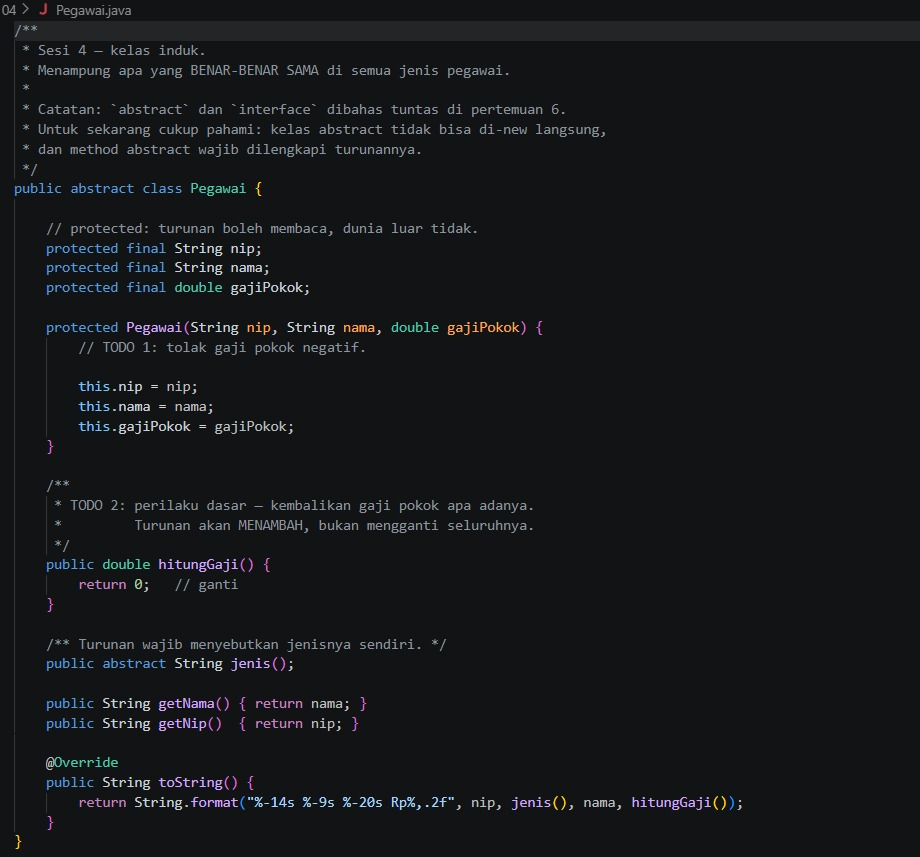

Kelas induk abstrak untuk semua jenis pegawai. Yang diminta:
1. TODO 1: tolak gaji pokok negatif di constructor.
2. TODO 2: `hitungGaji()` mengembalikan gaji pokok apa adanya, karena turunan akan menambah, bukan mengganti.

Pada tahap ini `hitungGaji()` masih mengembalikan 0 dan gaji negatif belum ditolak.

### Setelah

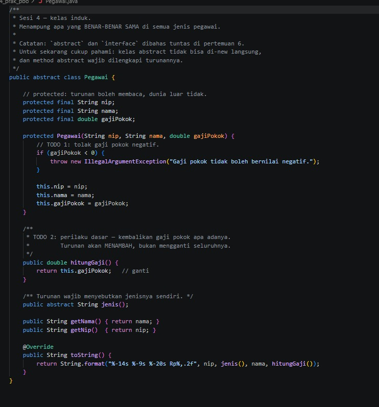

- Constructor melempar `IllegalArgumentException` bila `gajiPokok < 0`, sehingga objek dengan gaji negatif tidak pernah terbentuk.
- `hitungGaji()` mengembalikan `this.gajiPokok`. Ini perilaku dasar yang akan dipakai turunan lewat `super.hitungGaji()`.
- `nip`, `nama`, dan `gajiPokok` bersifat `protected final`, jadi turunan boleh membacanya tetapi tidak bisa mengubahnya.
- `jenis()` bersifat `abstract`, jadi setiap turunan wajib menyebutkan jenisnya sendiri.

---

## PegawaiTetap.java

### Sebelum

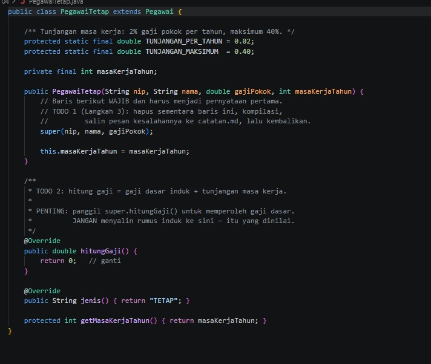

Turunan dari `Pegawai` dengan tunjangan masa kerja 2% per tahun, maksimum 40%. Yang diminta:
1. TODO 1: panggilan `super(...)` wajib menjadi pernyataan pertama. Langkah percobaannya adalah menghapusnya sementara, mengompilasi untuk melihat pesan error, lalu mengembalikannya.
2. TODO 2: hitung gaji dari gaji dasar induk ditambah tunjangan. Harus memanggil `super.hitungGaji()` dan tidak boleh menyalin rumus induk.

### Setelah

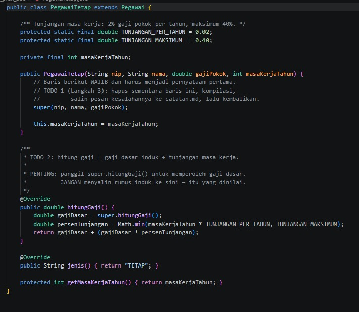

- `super(nip, nama, gajiPokok)` tetap menjadi baris pertama constructor, karena constructor induk harus berjalan lebih dulu.
- `hitungGaji()` mengambil `gajiDasar` dari `super.hitungGaji()`, bukan dari rumus salinan.
- Persen tunjangan dihitung dengan `Math.min(masaKerjaTahun * 0.02, 0.40)`, jadi tunjangan tidak pernah melebihi 40%.
- Hasilnya `gajiDasar + gajiDasar * persenTunjangan`. Untuk Ani (6.000.000, 15 tahun) hasilnya 7.800.000.

---

## PegawaiKontrak.java

### Sebelum

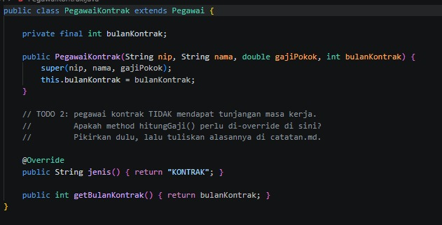

Pegawai kontrak tidak mendapat tunjangan masa kerja. Pertanyaan pada TODO 2: apakah `hitungGaji()` perlu di-override di sini?

### Setelah

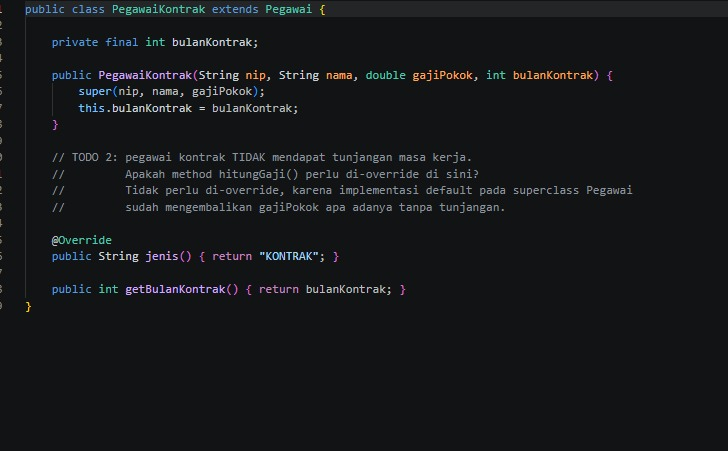

Tidak perlu di-override. Implementasi default di `Pegawai` sudah mengembalikan gaji pokok tanpa tunjangan, yang memang perilaku pegawai kontrak. Kelas ini hanya menambah `bulanKontrak` dan menyebut jenisnya `"KONTRAK"`. Dengan tidak menyalin kode, jika aturan gaji dasar berubah, pegawai kontrak ikut berubah otomatis.

## PegawaiHarian.java

### Sebelum

File belum ada. Kelas ini dibuat pada Langkah 4: pegawai yang digaji per hari kerja.

### Setelah

- Gaji pokok diperlakukan sebagai upah per hari, dan constructor menolak hari kerja negatif.
- `hitungGaji()` adalah `gajiPokok * hariKerja`. Method ini mengganti total rumus induk, bukan menambahnya.
- Contoh Citra Dewi: 150.000 x 22 hari = 3.300.000.

---

## Main.java

### Sebelum

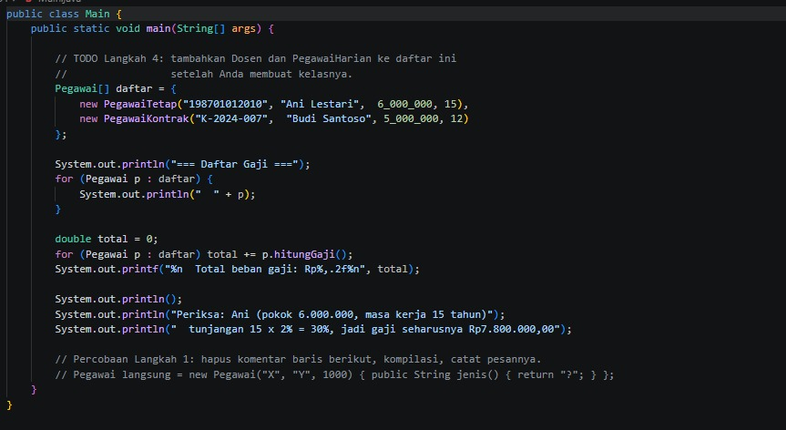

Program uji dengan daftar `Pegawai[]` yang baru berisi `PegawaiTetap` dan `PegawaiKontrak`. Daftar itu dicetak lalu dijumlahkan menjadi total beban gaji. Dosen dan PegawaiHarian belum ditambahkan.

### Setelah

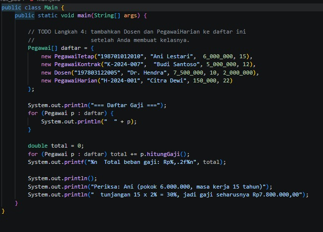

`PegawaiHarian` sudah masuk ke daftar. Satu array bertipe `Pegawai` menampung keempat jenis objek, dan `hitungGaji()` serta `jenis()` dipanggil sesuai kelas aslinya masing-masing (polimorfisme).

---

## Pegawai.php

### Sebelum

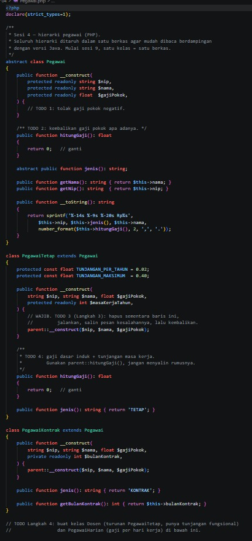

Versi PHP dari hierarki yang sama, seluruh kelasnya ditaruh dalam satu berkas. Pada tahap ini hanya ada `Pegawai`, `PegawaiTetap`, dan `PegawaiKontrak`, dengan TODO yang sama seperti versi Java: tolak gaji negatif, `hitungGaji()` dasar, dan `hitungGaji()` pegawai tetap lewat `parent::hitungGaji()`. Kelas `Dosen` dan `PegawaiHarian` belum dibuat.

### Setelah

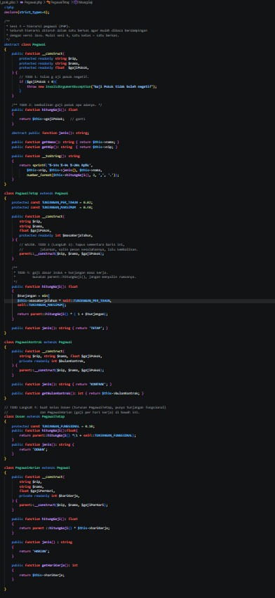

- `Pegawai` menolak gaji negatif dengan `InvalidArgumentException` dan mengembalikan `$this->gajiPokok` pada `hitungGaji()`.
- `PegawaiTetap::hitungGaji()` memakai `min(masaKerja * 0.02, 0.40)` lalu `parent::hitungGaji() * (1 + $tunjangan)`.
- `PegawaiKontrak` tidak meng-override `hitungGaji()`, sama seperti versi Java.
- `Dosen extends PegawaiTetap` menambah konstanta `TUNJANGAN_FUNGSIONAL = 0.10`, sehingga gajinya `parent::hitungGaji() * 1.10`. Pada versi PHP, tunjangan fungsional berupa persen tetap 10%, bukan nominal seperti di Java.
- `PegawaiHarian` menghitung `parent::hitungGaji() * $hariKerja`.

---

## main.php

### Sebelum

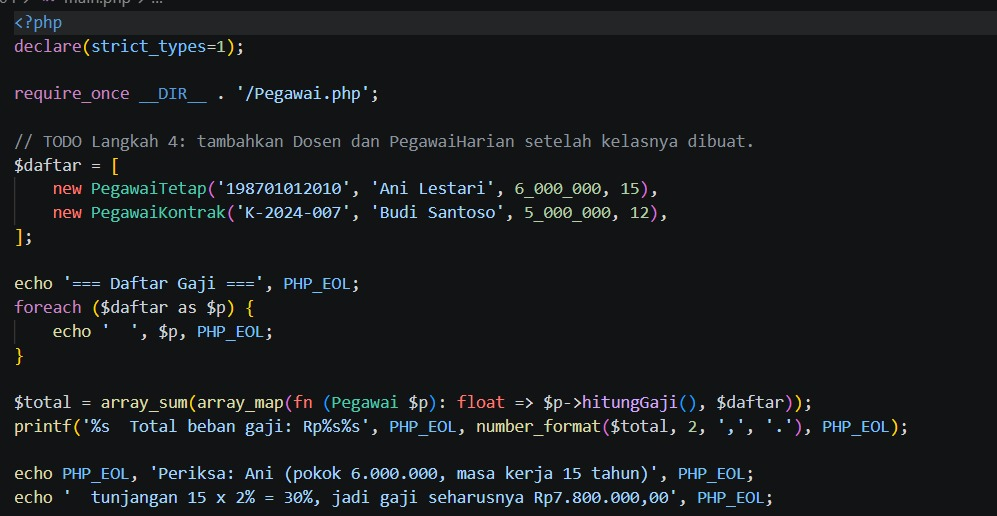

Program uji PHP dengan daftar pegawai yang baru berisi `PegawaiTetap` dan `PegawaiKontrak`.

### Setelah

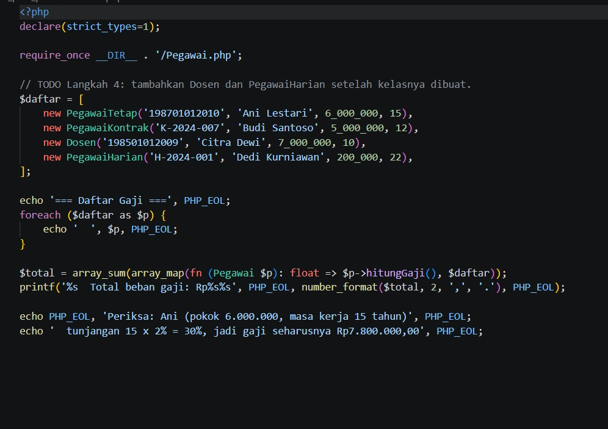

`Dosen` dan `PegawaiHarian` sudah ditambahkan ke daftar. Total beban gaji dihitung dengan `array_map` dan `array_sum`, dan tiap objek memakai `hitungGaji()` miliknya sendiri.

---

## Hasil Keseluruhan

### Sebelum (Java)

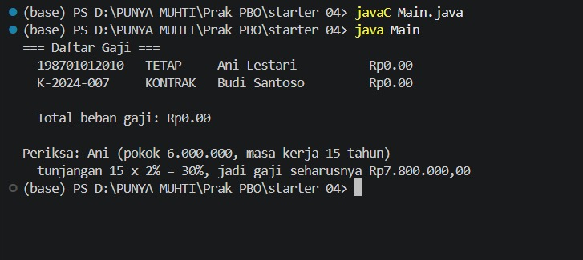

### Sebelum (PHP)

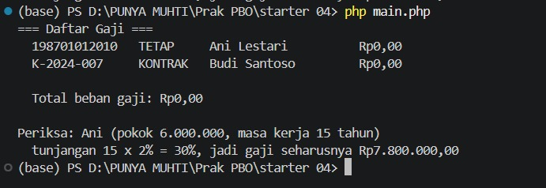

Semua gaji bernilai 0 karena `hitungGaji()` belum dikerjakan, dan hanya ada dua jenis pegawai.

### Setelah (Java)

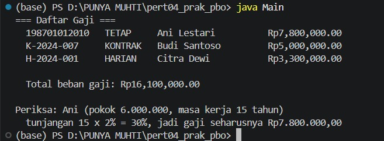

### Setelah (PHP)

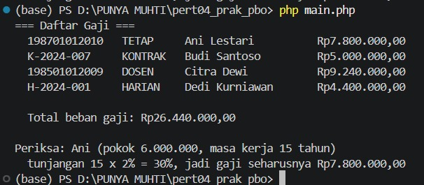

### Kesimpulan

Setelah semua TODO dikerjakan, gaji Ani tepat Rp7.800.000 (sesuai baris "Periksa") di Java maupun PHP, dan keempat jenis pegawai dihitung dengan benar. Total beban gaji Java adalah Rp27.100.000 dan PHP Rp26.440.000. Angkanya berbeda karena data dan aturan tunjangan fungsional dosen di kedua versi tidak sama (nominal di Java, 10% di PHP), bukan karena ada kesalahan.

Konsep yang dipelajari:
- Pewarisan (`extends`) menaruh hal yang sama di kelas induk, sehingga turunan hanya menulis yang berbeda.
- `super(...)` / `parent::__construct(...)` harus memanggil constructor induk lebih dulu.
- `super.hitungGaji()` / `parent::hitungGaji()` dipakai untuk menambah perilaku induk tanpa menyalin rumusnya.
- Tidak semua turunan perlu meng-override. `PegawaiKontrak` cukup memakai perilaku induk.
- Polimorfisme: satu daftar bertipe `Pegawai` menampung berbagai jenis pegawai, dan masing-masing menghitung gajinya sendiri.
