## Identitas

- Nama           : [Nur Wahyu Muhtiin Haniv]
- NPM            : [4525210078]
- Mata Kuliah    : [Praktikum PBO-A]
- Dosen Pengampu : [Adi Wahyu Pribadi, S.Si., M.Kom]

---

## BangunDatar.java

### Sebelum

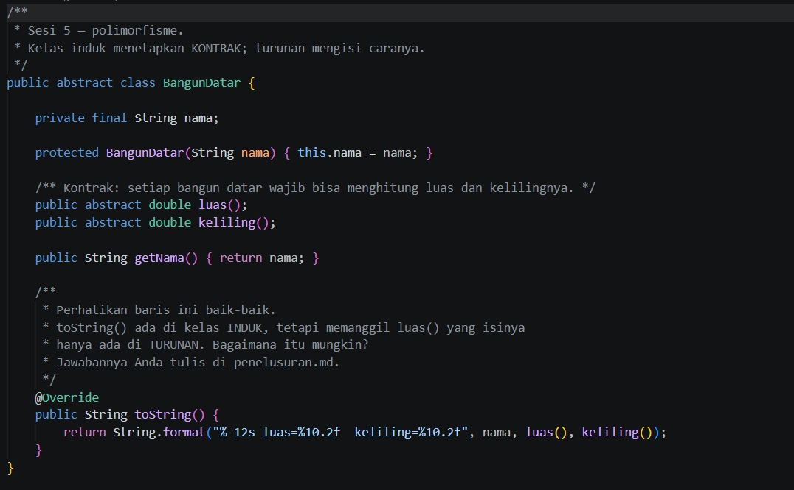

Kelas induk abstrak yang menetapkan kontrak: setiap bangun datar wajib bisa menghitung `luas()` dan `keliling()`. Pertanyaan pada komentar: `toString()` ada di kelas induk tetapi memanggil `luas()` yang isinya hanya ada di turunan, bagaimana itu mungkin?

### Setelah

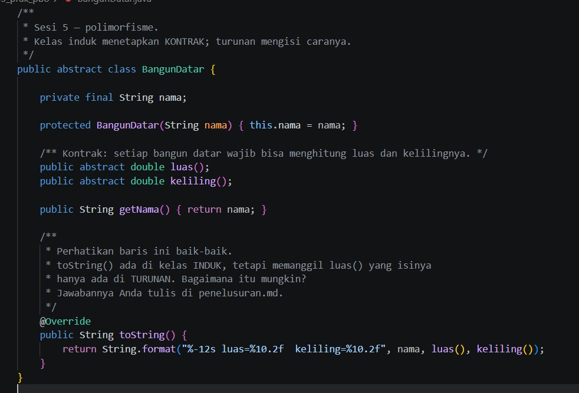

Tidak ada perubahan. Jawaban pertanyaannya adalah dynamic dispatch (late binding). Java memilih method yang dijalankan berdasarkan tipe objek sebenarnya saat program berjalan, bukan tipe variabelnya. Saat `toString()` memanggil `luas()`, yang jalan adalah `luas()` milik `Lingkaran`, `Persegi`, dan seterusnya, sesuai objek yang sedang dipakai.

---

## Lingkaran.java

### Sebelum

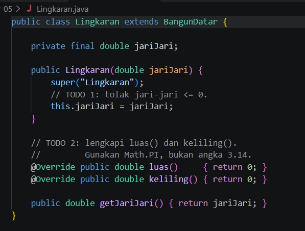

Dua TODO:
1. Tolak jari-jari <= 0.
2. Lengkapi `luas()` dan `keliling()` memakai `Math.PI`, bukan 3.14.

Saat ini keduanya masih mengembalikan 0.

### Setelah

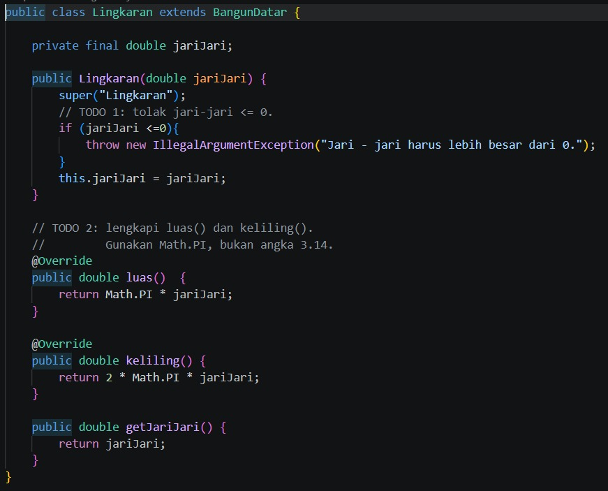

- Constructor melempar `IllegalArgumentException` bila jari-jari <= 0.
- `luas()` adalah `Math.PI * jariJari * jariJari`. Pada kode yang diunggah, rumusnya `Math.PI * jariJari` (tanpa kuadrat), sehingga Lingkaran(7) bernilai 21,99. Setelah diperbaiki hasilnya 153,94 sesuai baris "Periksa".
- `keliling()` adalah `2 * Math.PI * jariJari`.

---

## Persegi.java

### Sebelum

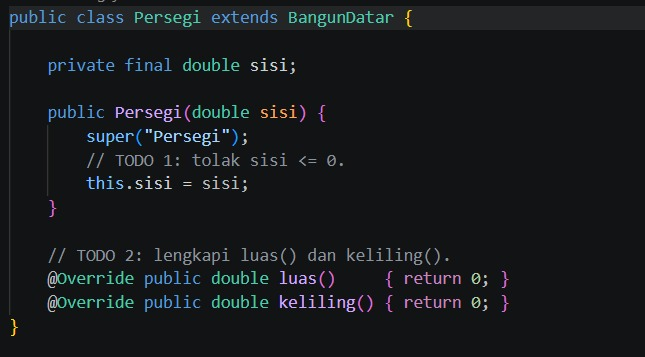

Dua TODO yang sama: tolak sisi <= 0, lalu lengkapi `luas()` dan `keliling()`.

### Setelah

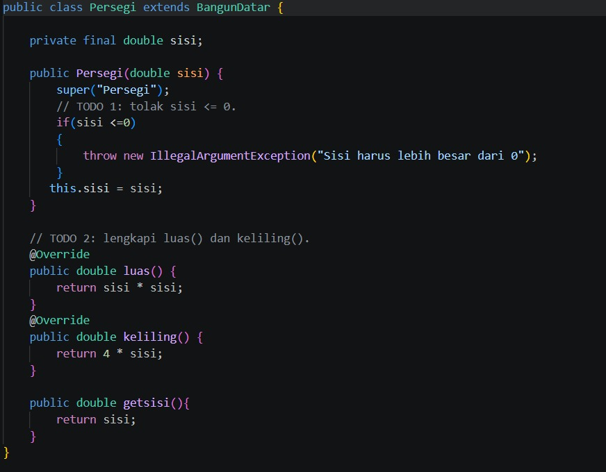

- Constructor menolak sisi <= 0 dengan `IllegalArgumentException`.
- `luas()` adalah `sisi * sisi` dan `keliling()` adalah `4 * sisi`.

---

## Segitiga.java

### Sebelum

File belum ada. Kelas ini dibuat pada Langkah 2.

### Setelah

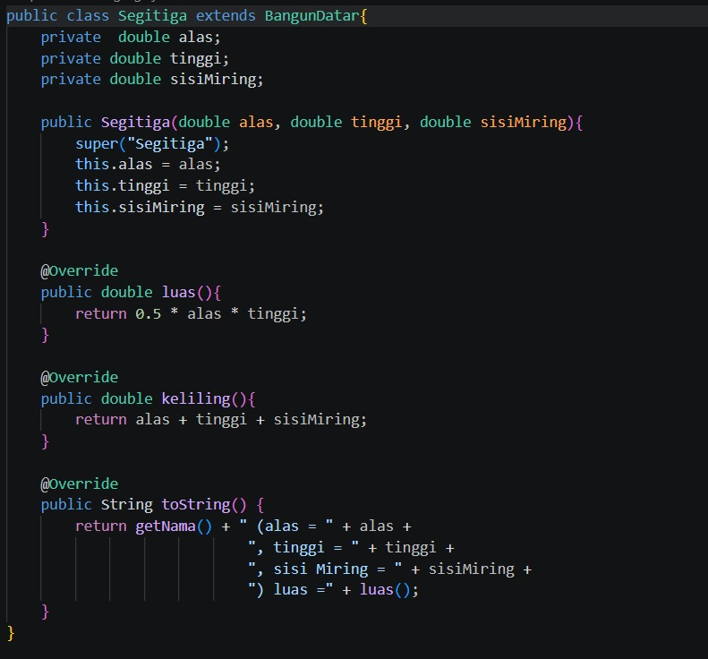

Turunan `BangunDatar` dengan alas, tinggi, dan sisi miring. `luas()` adalah `0.5 * alas * tinggi`, dan `keliling()` adalah jumlah ketiga sisi. Segitiga(3, 4, 5) menghasilkan luas 6.

---

## Trapesium.java

### Sebelum

File belum ada. Kelas ini dibuat pada Langkah 4.

### Setelah

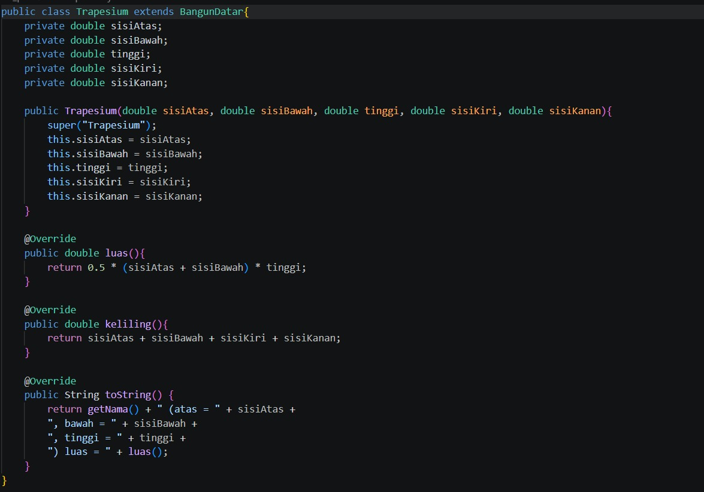

Turunan `BangunDatar` dengan sisi atas, sisi bawah, tinggi, serta sisi kiri dan kanan. `luas()` adalah `0.5 * (atas + bawah) * tinggi`, dan `keliling()` adalah jumlah keempat sisi. Trapesium(10, 6, 5, 5, 4) menghasilkan luas 40.

---

## Main.java

### Sebelum

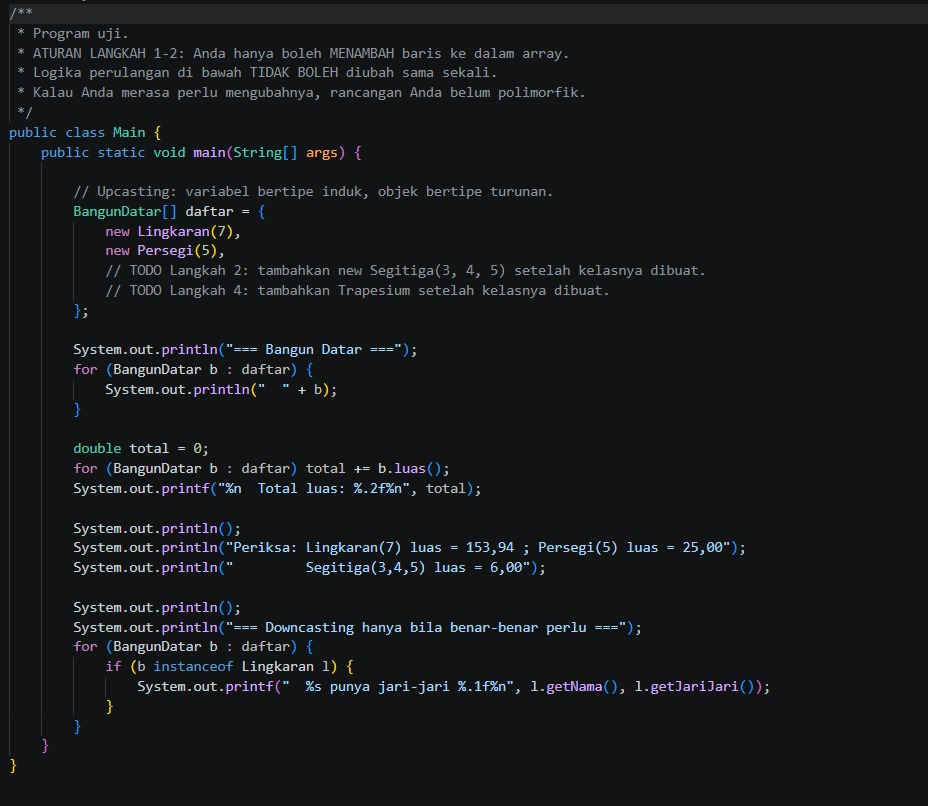

Program uji. Aturannya: hanya boleh menambah isi array, sedangkan perulangan di bawahnya tidak boleh diubah. Daftar baru berisi `Lingkaran` dan `Persegi`. Segitiga dan Trapesium ditambahkan setelah kelasnya dibuat.

### Setelah

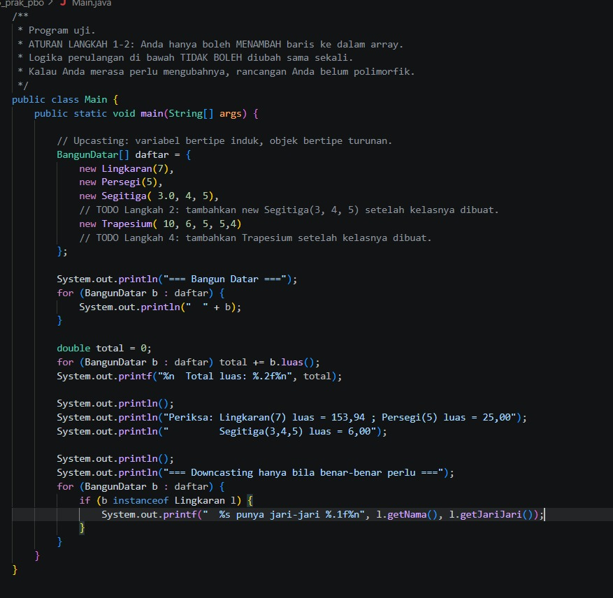

`Segitiga` dan `Trapesium` sudah ditambahkan ke array, tanpa mengubah logika perulangan sama sekali. Itu menunjukkan rancangannya sudah polimorfik: array bertipe `BangunDatar` menampung semua bentuk dan `luas()` yang berjalan mengikuti objek aslinya. Downcasting dengan `instanceof Lingkaran` hanya dipakai untuk mengambil jari-jari, yaitu hal yang tidak dimiliki bentuk lain.

---

## AntiPattern.java

### Sebelum

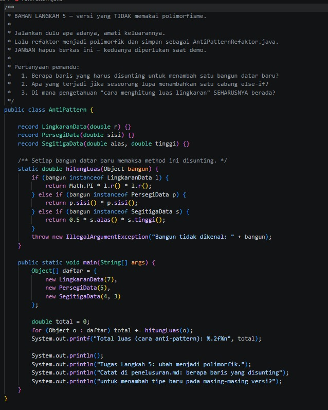

Versi tanpa polimorfisme. Satu method `hitungLuas(Object)` memeriksa tipe dengan rangkaian `if ... instanceof`. Tugasnya: jalankan dulu, lalu refaktor menjadi polimorfik dan simpan sebagai `AntiPatternRefaktor.java`.

### Setelah

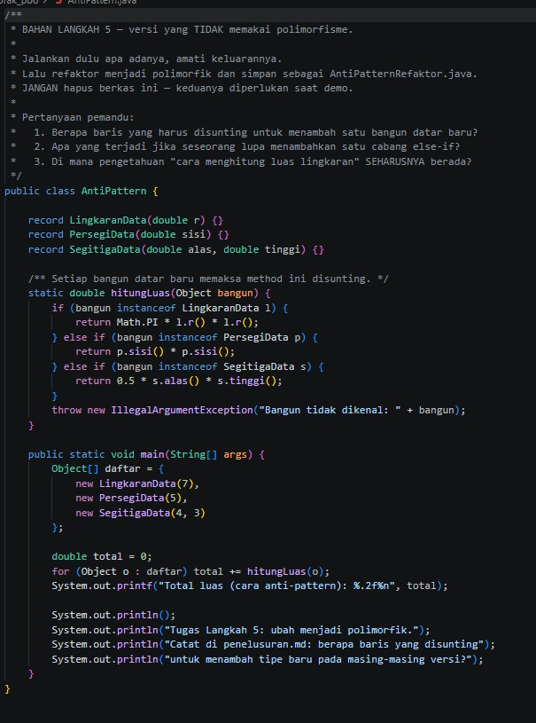

File ini sengaja tidak diubah, karena keduanya diperlukan saat demo. Jawaban pertanyaan pemandu:
1. Untuk menambah bangun baru, `hitungLuas()` harus disunting dengan menambah satu cabang `else if`, selain menambah record baru. Pada versi polimorfik tidak ada kode lama yang disunting, cukup menambah kelas baru dan memasukkannya ke array.
2. Kalau lupa menambah cabang, program baru gagal saat dijalankan (melempar `IllegalArgumentException`), bukan saat kompilasi.
3. Pengetahuan cara menghitung luas lingkaran seharusnya berada di kelas lingkaran itu sendiri.

---

## AntiPatternRefaktor.java

### Sebelum

File belum ada. Dibuat pada Langkah 5 sebagai hasil refaktor.

### Setelah

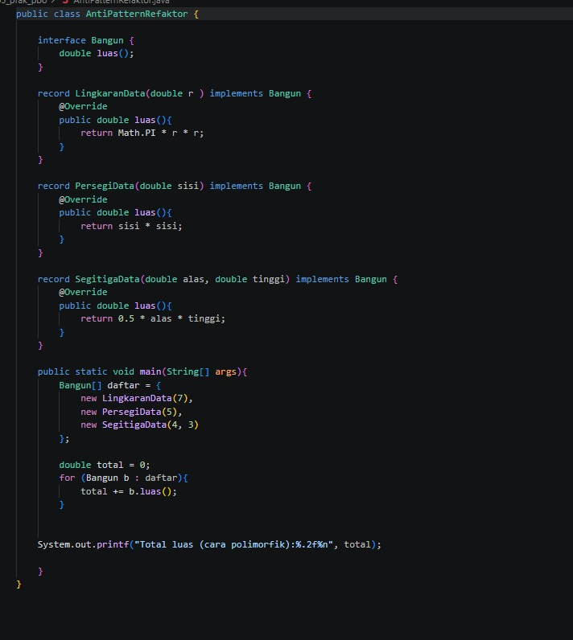

Dibuat interface `Bangun` dengan method `luas()`. Setiap record (`LingkaranData`, `PersegiData`, `SegitigaData`) mengimplementasikannya dan menghitung luasnya sendiri. Perulangan cukup memanggil `b.luas()` tanpa `instanceof`, dan totalnya sama dengan versi lama yaitu 184,94.

---

## BangunDatar.php

### Sebelum

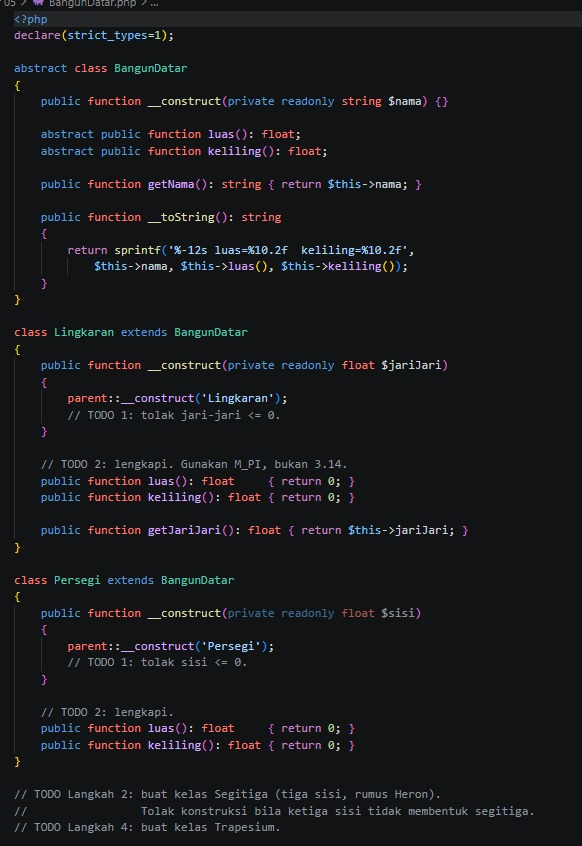

Versi PHP dengan kelas `BangunDatar`, `Lingkaran`, dan `Persegi`. Validasi dan rumus luas serta keliling masih kosong (TODO 1 dan 2). Kelas `Segitiga` (rumus Heron) dan `Trapesium` belum ada.

### Setelah

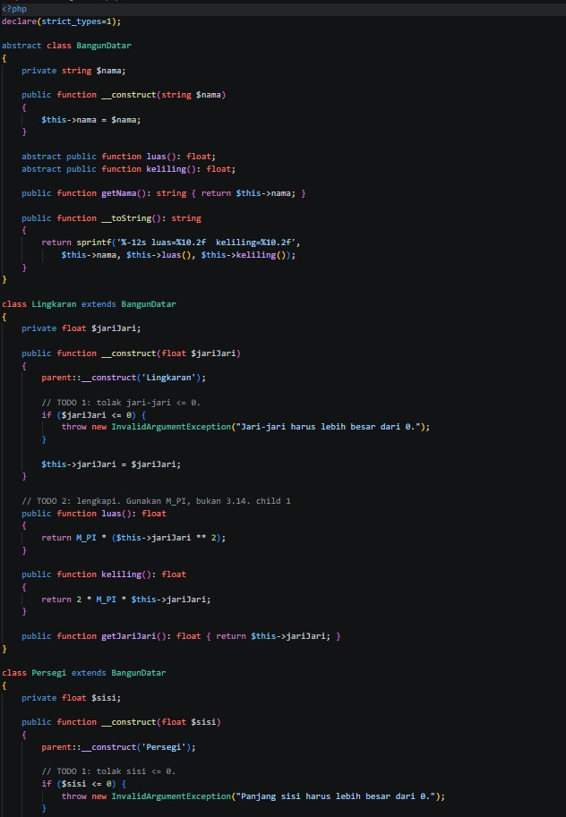
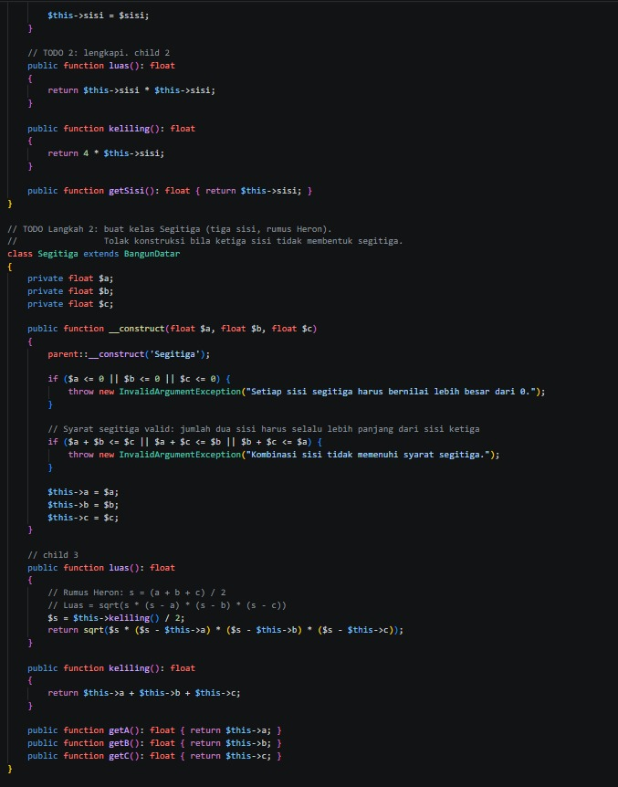
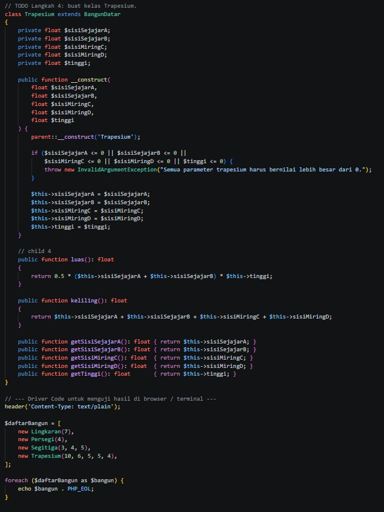

- `Lingkaran` memakai `M_PI` dan menolak jari-jari <= 0, `Persegi` menolak sisi <= 0, keduanya dengan `InvalidArgumentException`.
- `Segitiga` menghitung luas dengan rumus Heron dan menolak sisi yang tidak membentuk segitiga (jumlah dua sisi harus lebih panjang dari sisi ketiga).
- `Trapesium` dibuat sesuai Langkah 4 dan memvalidasi semua parameter harus positif.
- Blok kode uji di bagian bawah berkas saya hapus, karena membuat keluaran muncul dua kali saat `main.php` memuat berkas ini. Pengujian sudah ada di `main.php`.

---

## main.php

### Sebelum

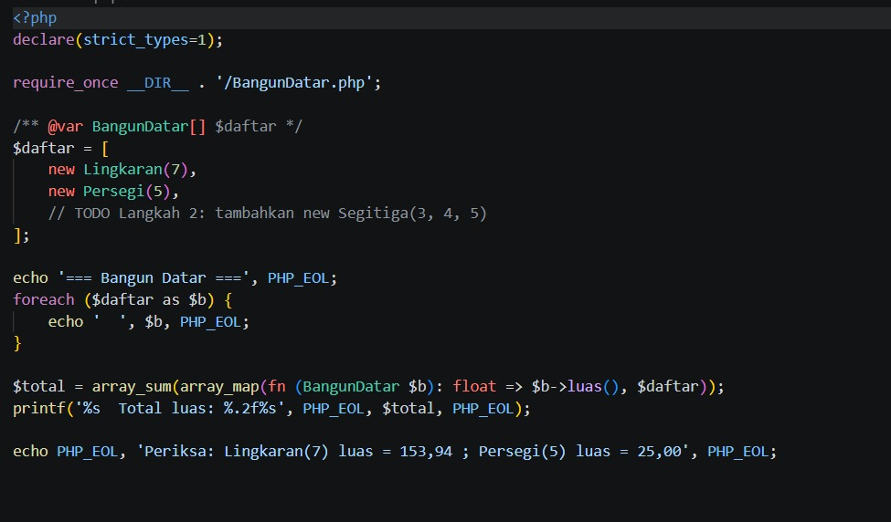

Program uji PHP yang baru berisi `Lingkaran` dan `Persegi`, dengan TODO untuk menambah `Segitiga`.

### Setelah

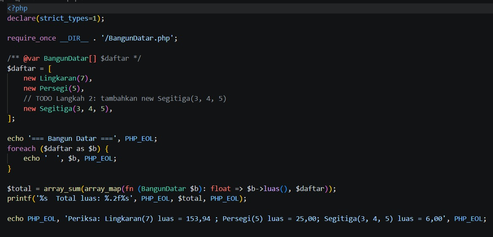

`Segitiga(3, 4, 5)` sudah ditambahkan, begitu pula `Trapesium(10, 6, 5, 5, 4)` untuk Langkah 4. Total luas dihitung dengan `array_map` dan `array_sum`, tanpa pemeriksaan tipe.

---

## notifikasi.php

### Sebelum

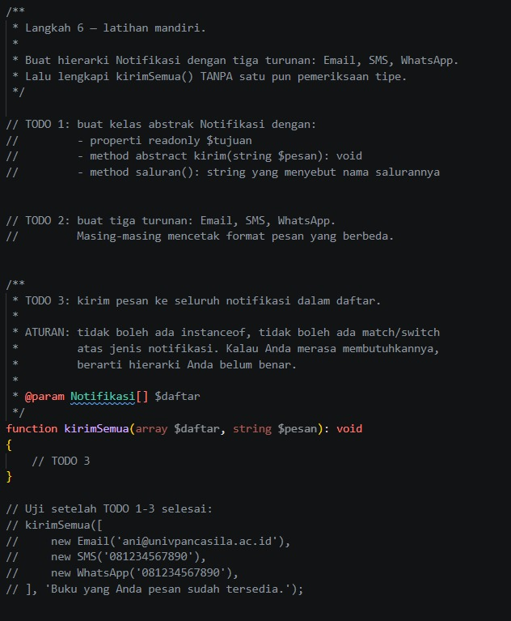

Latihan mandiri Langkah 6. Yang diminta:
1. Kelas abstrak `Notifikasi` dengan properti `readonly $tujuan`, method abstract `kirim()`, dan `saluran()`.
2. Tiga turunan: `Email`, `SMS`, `WhatsApp` dengan format pesan berbeda.
3. `kirimSemua()` tanpa `instanceof`, `match`, atau `switch` atas jenis.

### Setelah

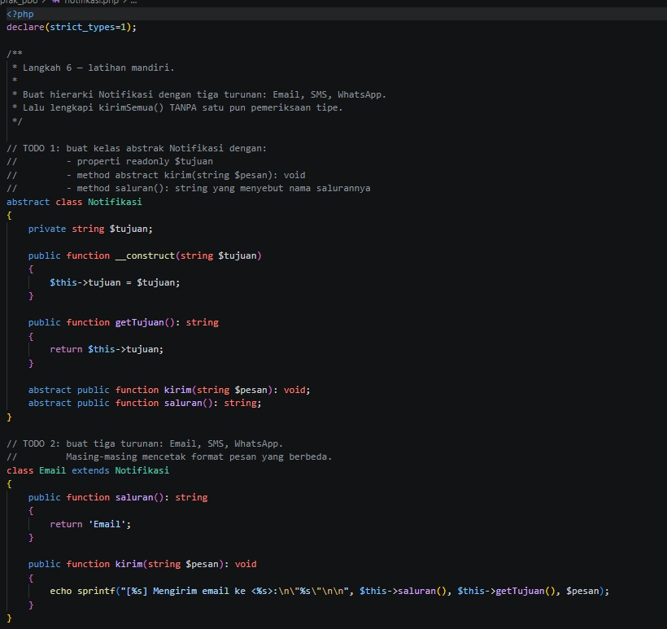
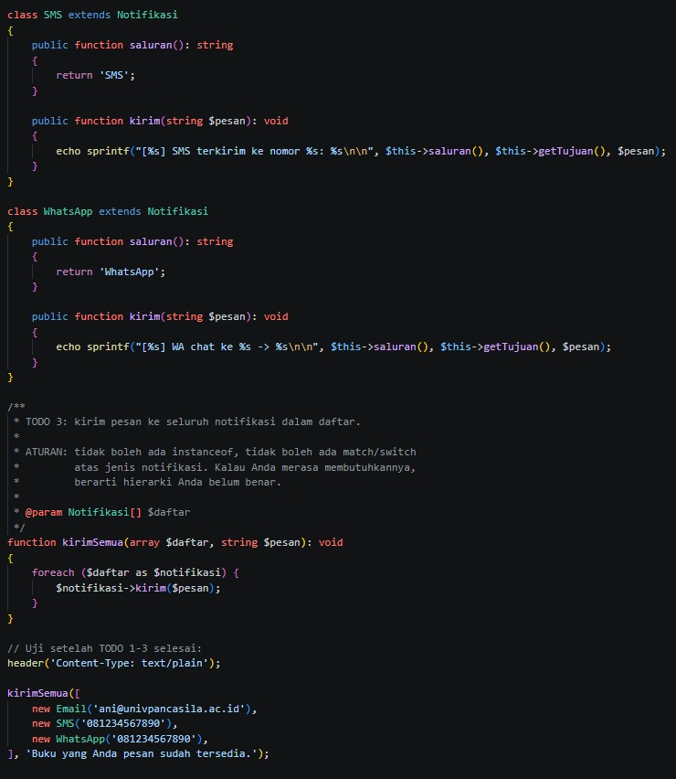

- `Notifikasi` abstrak dengan `private readonly string $tujuan` dan dua method abstract. Pada kode yang diunggah propertinya belum `readonly`, jadi saya sesuaikan dengan instruksi.
- `Email`, `SMS`, dan `WhatsApp` masing-masing mengisi `saluran()` dan `kirim()` dengan format pesan sendiri.
- `kirimSemua()` hanya berisi `foreach` yang memanggil `$notifikasi->kirim($pesan)`. Tidak ada pemeriksaan tipe, jadi menambah saluran baru tidak perlu mengubah fungsi ini.

---

## Hasil Keseluruhan

### Sebelum

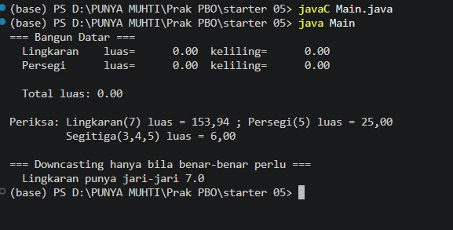

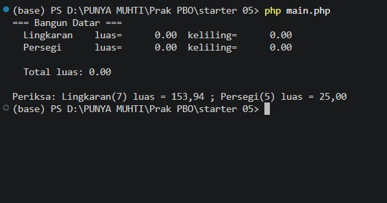

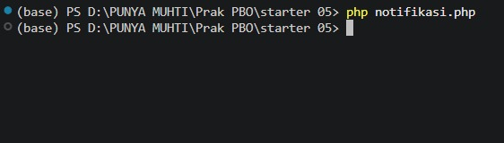

Semua luas 0,00 karena rumus belum dikerjakan, dan `notifikasi.php` berhenti dengan fatal error karena kelas `Email` belum ada.

### Setelah (Java)

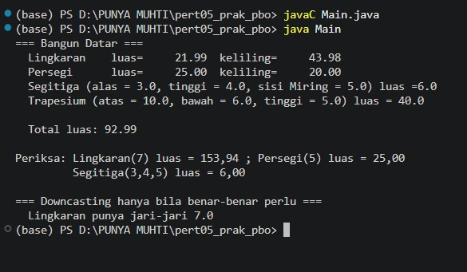

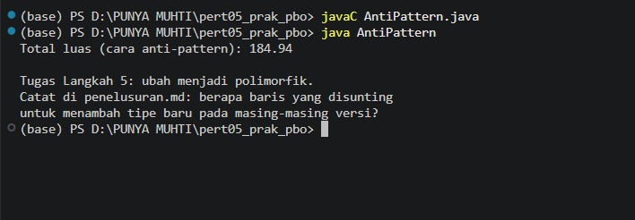

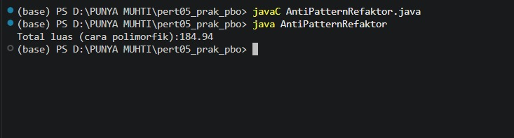

### Setelah (PHP)

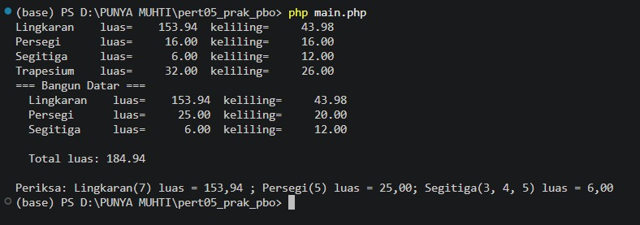

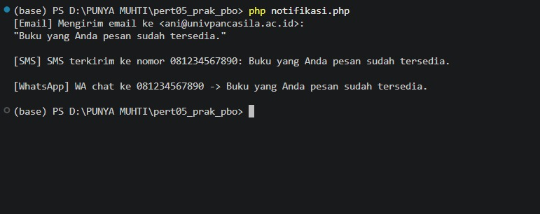

### Kesimpulan

Setelah semua tugas selesai, luas Lingkaran(7) = 153,94, Persegi(5) = 25,00, dan Segitiga(3,4,5) = 6,00, sesuai baris "Periksa". Versi anti-pattern dan versi polimorfik sama-sama menghasilkan total 184,94. Bedanya ada pada biaya perubahan: versi `if instanceof` harus disunting setiap ada bangun baru dan salahnya baru ketahuan saat program berjalan, sedangkan versi polimorfik cukup menambah kelas baru.

Konsep yang dipelajari:
- Polimorfisme: satu array bertipe induk menampung berbagai turunan, dan method yang jalan mengikuti objek aslinya (dynamic dispatch).
- Kelas induk menetapkan kontrak (`abstract`) dan turunan mengisi caranya sendiri.
- Perulangan tidak perlu diubah saat tipe baru ditambah (prinsip open/closed).
- Downcasting dengan `instanceof` hanya dipakai bila benar-benar perlu mengakses anggota khusus turunan.
- Pola yang sama berlaku di PHP (hierarki `Notifikasi`, `kirimSemua()` tanpa pemeriksaan tipe).
