## Identitas

- Nama           : [Nur Wahyu Muhtiin Haniv]
- NPM            : [4525210078]
- Mata Kuliah    : [Praktikum PBO-A]
- Dosen Pengampu : [Adi Wahyu Pribadi, S.Si., M.Kom]

---

## Movable.java

### Sebelum

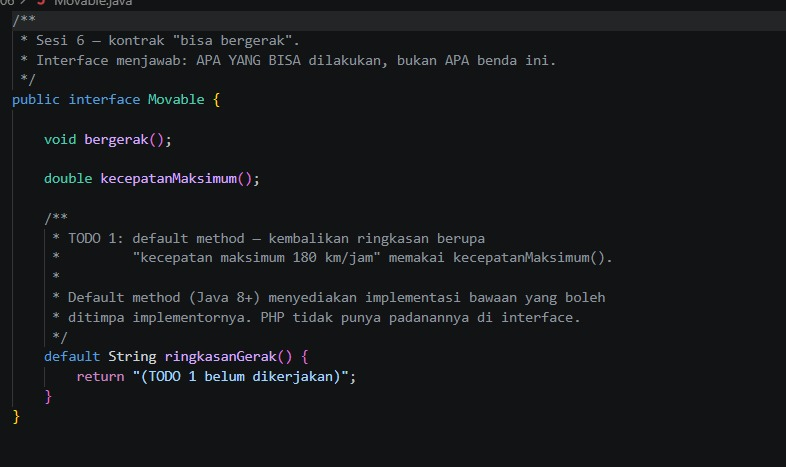

Interface kontrak "bisa bergerak" dengan `bergerak()` dan `kecepatanMaksimum()`. TODO 1 meminta `default method` `ringkasanGerak()` yang mengembalikan teks seperti "kecepatan maksimum 180 km/jam" memakai `kecepatanMaksimum()`. Saat ini method itu baru mengembalikan `"?"`.

### Setelah

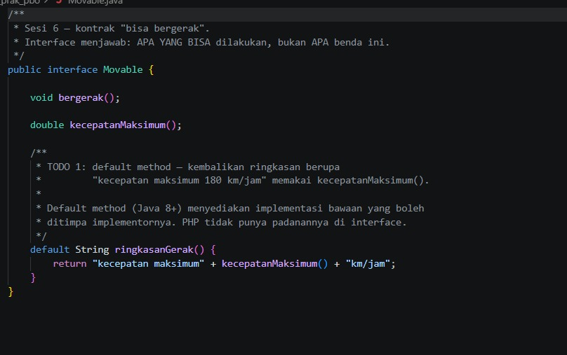

`ringkasanGerak()` sudah diisi sebagai default method, yaitu implementasi bawaan yang boleh ditimpa kelas yang mengimplementasikan interface. Pada kode yang diunggah, teksnya tertulis tanpa spasi ("kecepatan maksimum180.0km/jam"). Saya perbaiki sehingga hasilnya "kecepatan maksimum 180 km/jam".

---

## Fuelable.java

### Sebelum

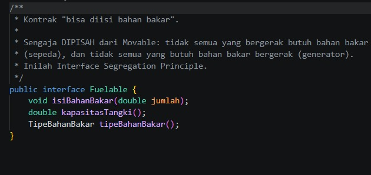

Interface kontrak "bisa diisi bahan bakar" yang sengaja dipisah dari `Movable`. Tidak semua yang bergerak butuh bahan bakar (sepeda), dan tidak semua yang butuh bahan bakar bergerak (generator). Ini penerapan Interface Segregation Principle.

### Setelah

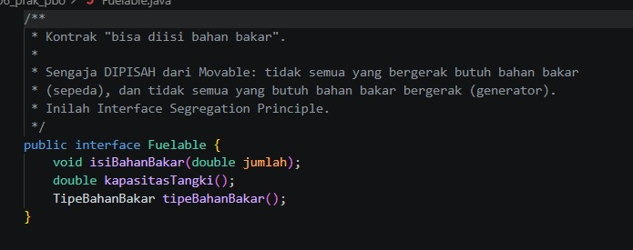

Tidak ada perubahan. Interface ini sudah lengkap dan hanya berisi kontrak `isiBahanBakar()`, `kapasitasTangki()`, dan `tipeBahanBakar()`.

---

## TipeBahanBakar.java

### Sebelum

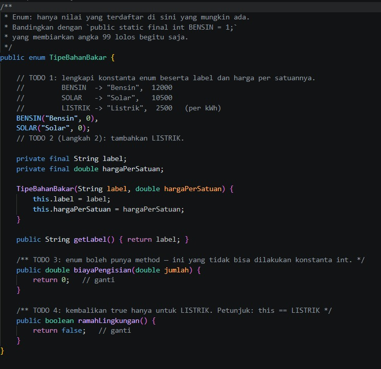

Enum dengan empat TODO:
1. Lengkapi konstanta beserta label dan harga: Bensin 12.000, Solar 10.500, Listrik 2.500.
2. Tambahkan `LISTRIK`.
3. `biayaPengisian()` adalah method pada enum, yang tidak bisa dilakukan konstanta `int`.
4. `ramahLingkungan()` bernilai true hanya untuk `LISTRIK`.

Saat ini baru ada `BENSIN`, dan kedua method masih mengembalikan nilai sementara.

### Setelah

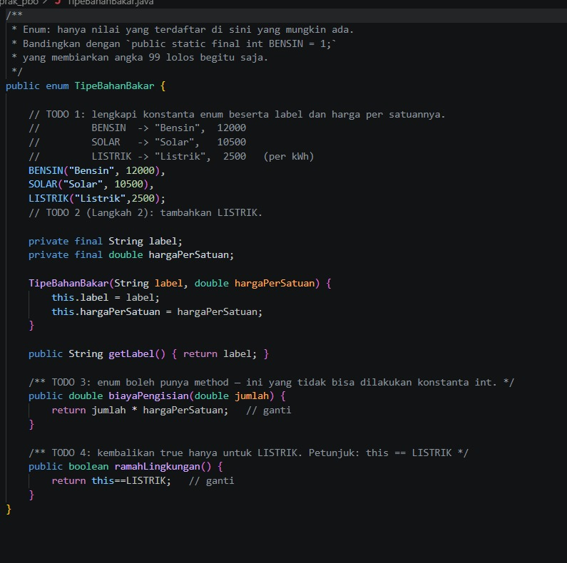

- Tiga konstanta `BENSIN`, `SOLAR`, `LISTRIK` memiliki label dan harga per satuan lewat constructor enum.
- `biayaPengisian(jumlah)` mengembalikan `jumlah * hargaPerSatuan`.
- `ramahLingkungan()` mengembalikan `this == LISTRIK`.
- Hanya nilai yang terdaftar yang mungkin ada. Berbeda dengan `static final int` yang membiarkan angka 99 lolos.

---

## Kendaraan.java

### Sebelum

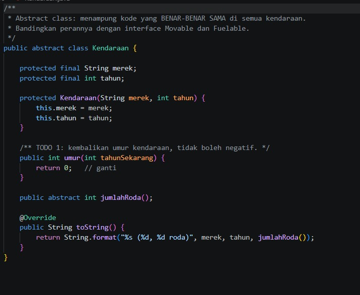

Abstract class yang menampung kode yang benar-benar sama di semua kendaraan (merek, tahun). TODO 1 meminta `umur()` yang tidak boleh negatif. Saat ini method itu masih mengembalikan 0.

### Setelah

`umur(tahunSekarang)` mengembalikan `Math.max(0, tahunSekarang - tahun)`, jadi kendaraan dari tahun yang belum tiba tidak menghasilkan umur negatif. Peran abstract class di sini adalah berbagi kode (atribut dan `umur()`), sedangkan interface hanya berisi kontrak.

---

## Mobil.java

### Sebelum

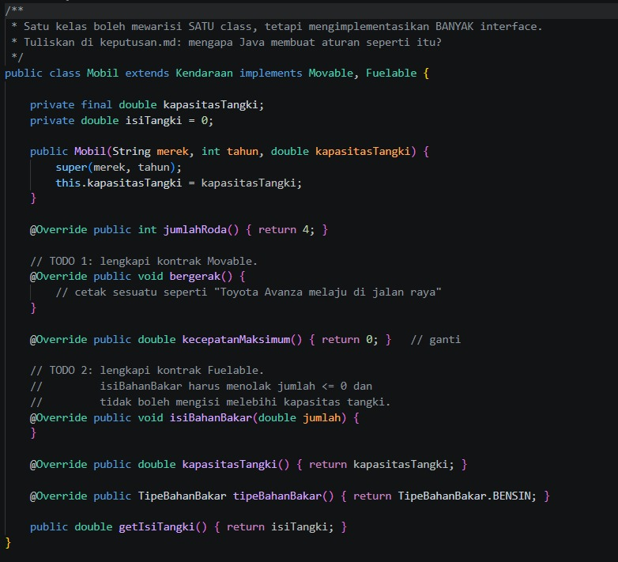

`Mobil extends Kendaraan implements Movable, Fuelable`. Yang diminta:
1. TODO 1: lengkapi kontrak `Movable` (`bergerak()` dan `kecepatanMaksimum()`).
2. TODO 2: lengkapi `isiBahanBakar()`, yaitu menolak jumlah <= 0 dan tidak boleh melebihi kapasitas tangki.
3. Tuliskan alasan Java hanya membolehkan satu `extends` tetapi banyak `implements`.

### Setelah

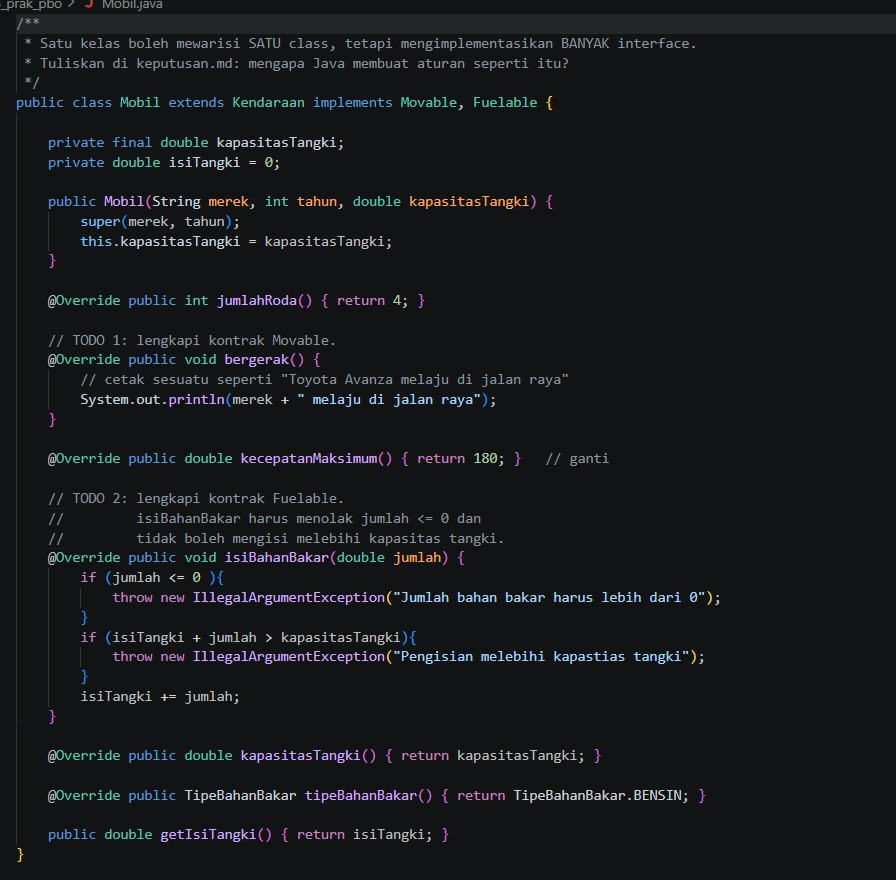

- `bergerak()` mencetak "Toyota Avanza melaju di jalan raya" dan `kecepatanMaksimum()` mengembalikan 180.
- `isiBahanBakar()` melempar `IllegalArgumentException` bila jumlah <= 0 atau `isiTangki + jumlah` melebihi kapasitas. Salah ketik pada pesan error ("kapastias") sudah saya perbaiki.
- `tipeBahanBakar()` mengembalikan `TipeBahanBakar.BENSIN`.
- Alasan aturan satu class dan banyak interface: kalau boleh mewarisi dua class, dan keduanya punya method serta atribut yang sama, Java tidak tahu mana yang dipakai (masalah diamond). Interface hanya berisi kontrak, sehingga satu kelas boleh memenuhi banyak kontrak tanpa ambigu.

---

## Sepeda.java

### Sebelum

File belum ada. Kelas ini dibuat pada Langkah 4: `Sepeda` adalah `Movable` tetapi bukan `Fuelable`.

### Setelah

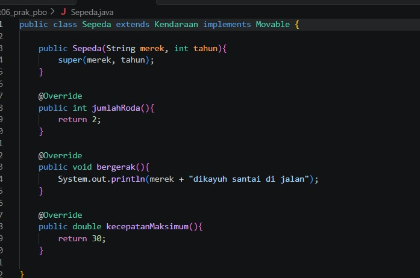

`Sepeda extends Kendaraan implements Movable`, tanpa `Fuelable`. Jumlah roda 2, kecepatan maksimum 30, dan `bergerak()` mencetak "Polygon dikayuh santai di jalan" (spasi yang hilang sudah saya perbaiki). Karena tidak mengimplementasikan `Fuelable`, sepeda tidak punya tangki, sesuai dunia nyata.

---

## Main.java

### Sebelum

Program uji. `isiPenuh(Fuelable)` menerima tipe kontrak, bukan kelas `Mobil`. Daftar `Movable` baru berisi `Mobil`, dan `Sepeda` ditambahkan setelah kelasnya dibuat. Ada juga tugas mencoba `isiPenuh(sepeda)` untuk melihat penolakan saat kompilasi.

### Setelah

`Sepeda` sudah masuk ke daftar `Movable`. Method `isiPenuh()` tetap tidak diubah dan bekerja untuk kelas apa pun yang `implements Fuelable`. Baris `isiPenuh(sepeda)` tetap dikomentari supaya program bisa dijalankan. Hasil percobaan membukanya ada di bagian Hasil Keseluruhan.

---

## abstraksi.php

### Sebelum

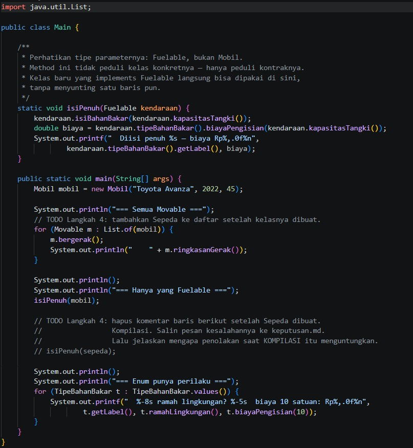
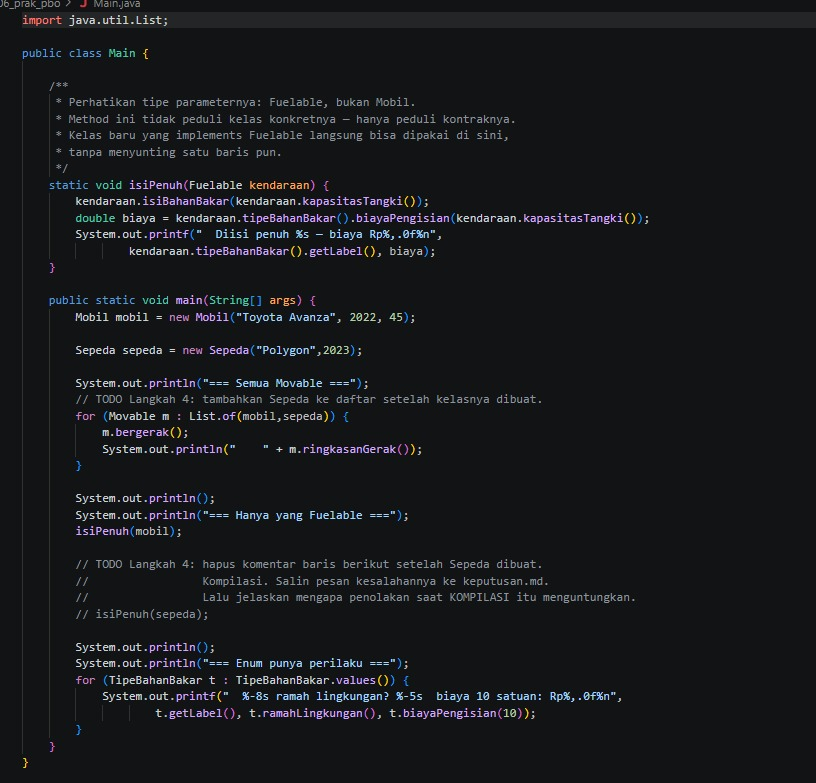

Versi PHP yang menggabungkan semua konsep dalam satu berkas: interface `Movable` dan `Fuelable`, enum `TipeBahanBakar`, trait `Loggable`, abstract class `Kendaraan`, dan `Mobil`. Yang diminta:
1. Tambahkan case `Listrik`.
2. Isi `label()`, `hargaPerSatuan()`, `biayaPengisian()`, dan `ramahLingkungan()` pada enum.
3. TODO 6: `log()` pada trait mencetak `[jam] NamaKelas: pesan`.
4. TODO 7: `umur()` tidak boleh negatif.
5. TODO 8: lengkapi kontrak `Mobil`.
6. Langkah 4 dan 5: buat `Sepeda` (bukan `Fuelable`) dan `Pesanan` yang juga memakai trait.

### Setelah

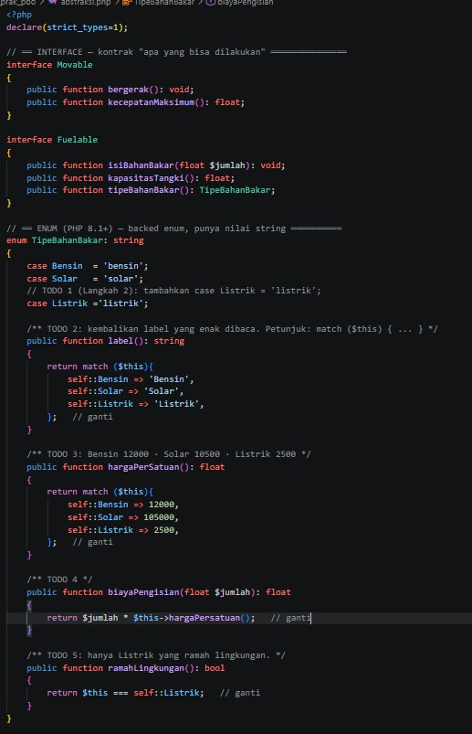
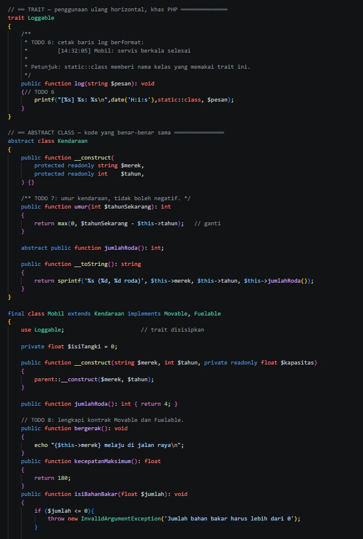
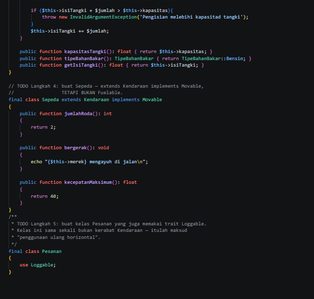

- Enum `TipeBahanBakar: string` punya tiga case. `label()` dan `hargaPerSatuan()` memakai `match ($this)`, dan `ramahLingkungan()` memakai `$this === self::Listrik`. Pada kode yang diunggah, harga Solar tertulis 105000. Saya perbaiki menjadi 10500.
- Trait `Loggable` mencetak `printf("[%s] %s: %s\n", date('H:i:s'), static::class, $pesan)`. Dengan `static::class`, nama yang tercetak adalah kelas pemakai trait ("Mobil" atau "Pesanan").
- `Kendaraan::umur()` memakai `max(0, ...)`.
- `Mobil` melengkapi `Movable` dan `Fuelable` dengan validasi jumlah <= 0 dan batas kapasitas (salah ketik "kapasitad" sudah saya perbaiki).
- `Sepeda` hanya `implements Movable`. `Pesanan` memakai trait `Loggable` padahal bukan kerabat `Kendaraan`, yaitu penggunaan ulang horizontal.

---

## main.php

### Sebelum

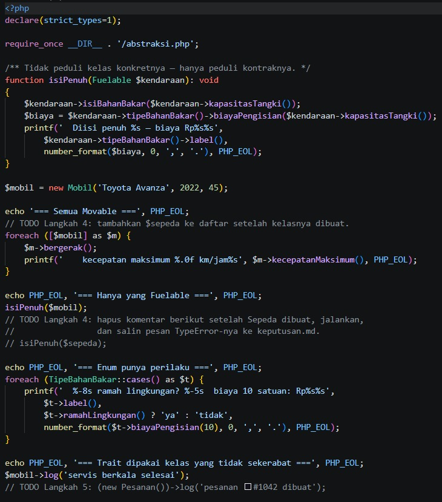

Program uji PHP. `isiPenuh(Fuelable $kendaraan)` hanya peduli kontraknya. Daftar `Movable` baru berisi `$mobil`, dan pemanggilan `log()` untuk `Pesanan` belum ada.

### Setelah

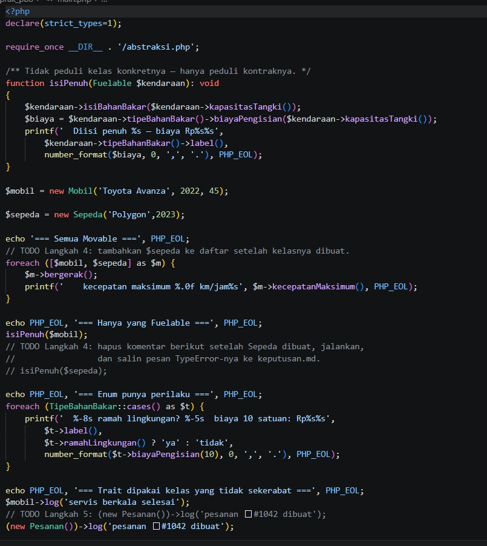

`$sepeda` sudah masuk daftar, dan `(new Pesanan())->log(...)` sudah aktif untuk menunjukkan trait dipakai kelas yang tidak sekerabat.

---

## Hasil Keseluruhan

### Sebelum

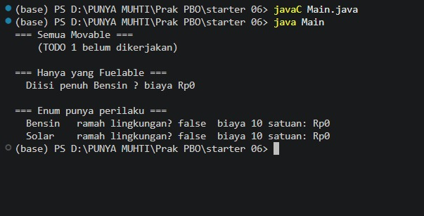

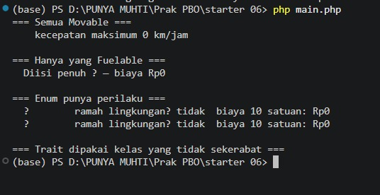

Teks bernilai `?`, biaya Rp0, dan hanya ada satu jenis bahan bakar, karena TODO belum dikerjakan.

### Setelah (Java)

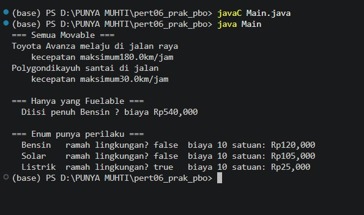

### Setelah (PHP)

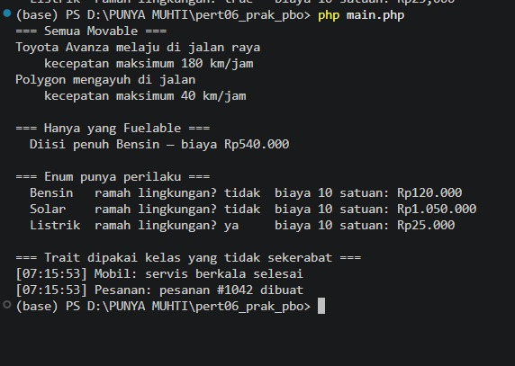

### Kesimpulan

Setelah semua TODO dikerjakan, Mobil dan Sepeda tampil sebagai `Movable`, hanya Mobil yang bisa diisi bahan bakar (45 liter x 12.000 = Rp540.000), dan hanya Listrik yang ramah lingkungan. Java dan PHP menghasilkan perilaku yang sama.

Penolakan `isiPenuh(sepeda)` menguntungkan karena kesalahan ketahuan lebih awal. Di Java kesalahan ini terdeteksi saat kompilasi, sebelum program dijalankan dan sebelum sampai ke pengguna. Di PHP, kesalahan yang sama berupa `TypeError` saat program berjalan. Kontrak yang dipisah (`Movable`, `Fuelable`) membuat sistem tipe bisa menjaga hal itu.

Konsep yang dipelajari:
- Interface menjawab "apa yang bisa dilakukan", abstract class menampung kode yang sama, dan satu kelas boleh `implements` banyak interface tetapi hanya `extends` satu class.
- Interface Segregation Principle: kontrak kecil dan terpisah (`Movable`, `Fuelable`).
- Default method hanya ada di interface Java. PHP tidak punya padanannya.
- Enum bisa punya data dan perilaku (Java enum dengan constructor, PHP backed enum dengan `match`).
- Trait di PHP memungkinkan penggunaan ulang kode lintas kelas yang tidak sekerabat.
