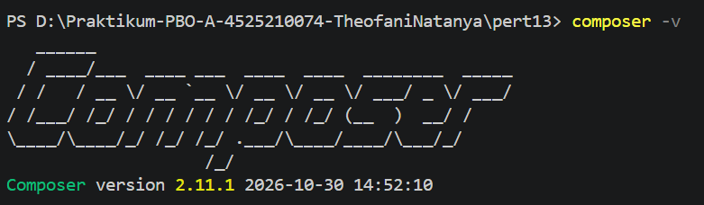
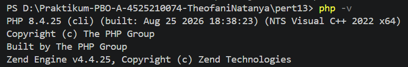
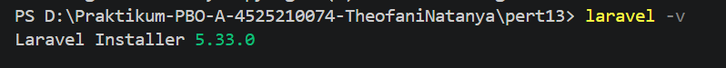
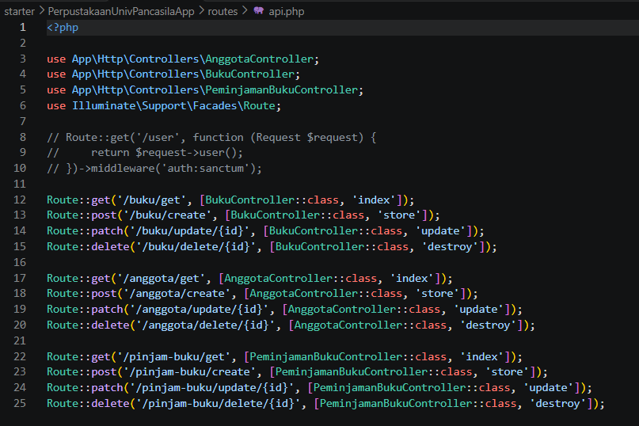
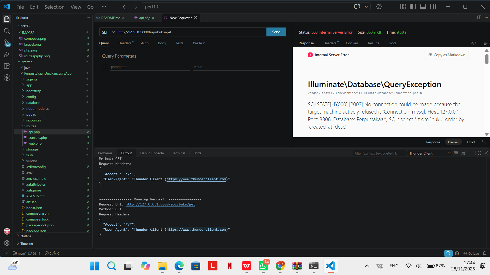
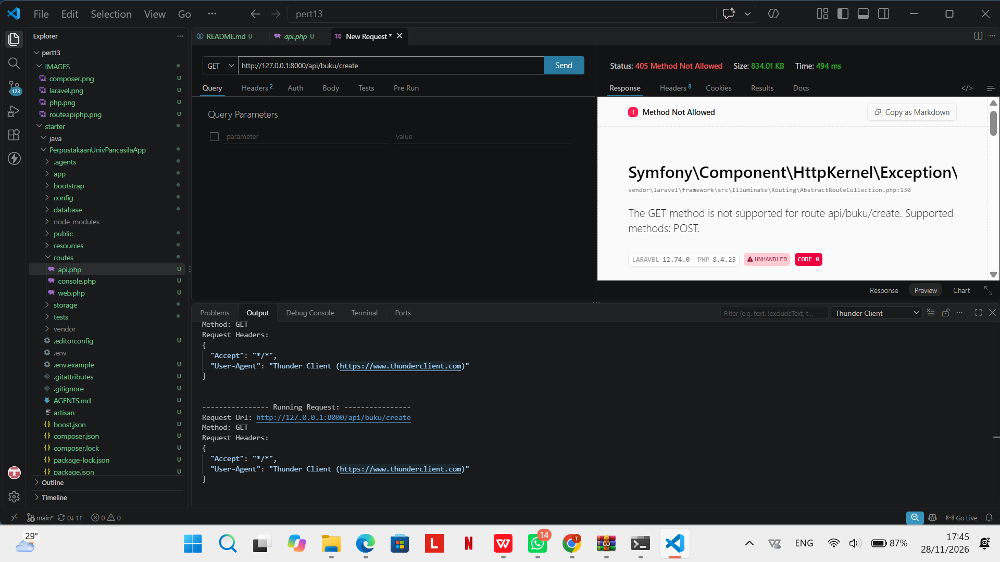

# LAPORAN PRAKTIKUM PBO - A 

NAMA        : Theofani Natanya Anari Hutabarat

NPM         : 4525210074

MATA KULIAH : Pemrograman Berbasis Objek

KELAS       : A

MATERI      : Pertemuan 13

DOSEN       : Adi Wahyu Pribadi, S.Si., M.Kom.

## Panduan instalasi

a. COMPOSER

b. PHP

c. LARAVEL

## Panduan running laravel

## Ss route (api.php)

## Percobaan hasil api per route

## Screenshot Route (api.php)

1. GET 
   

2. POST 
   

3. PATCH 
   

4. DELETE 
   
